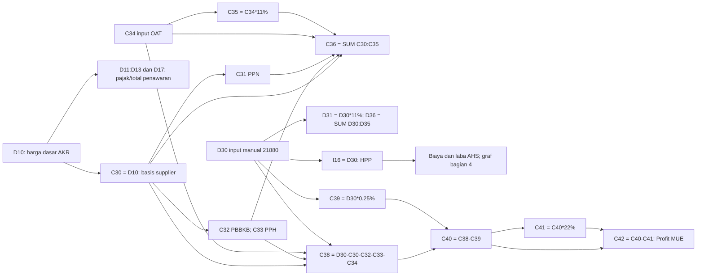
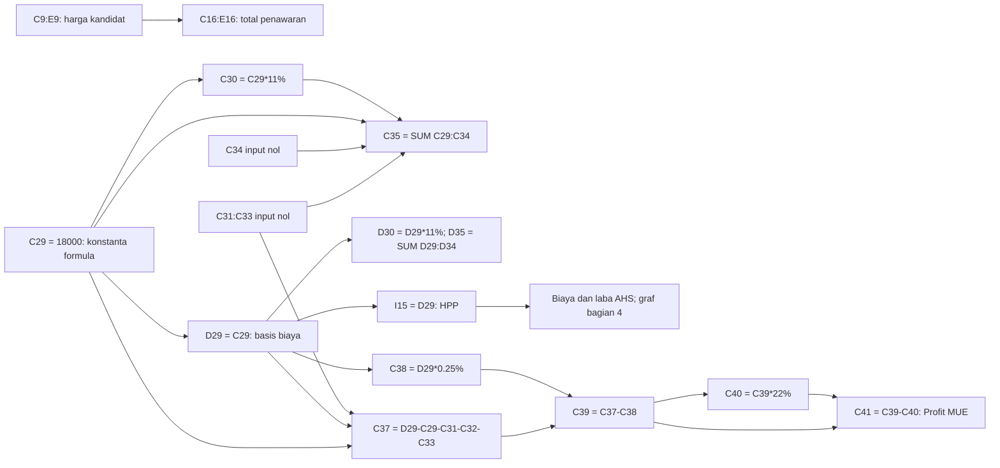
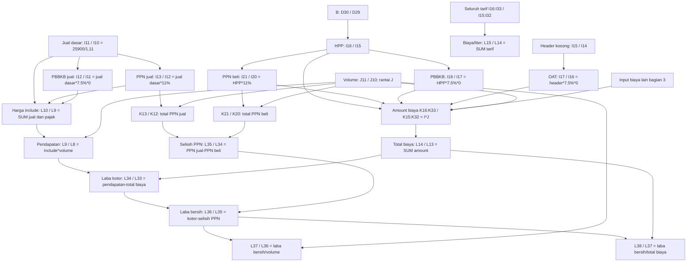
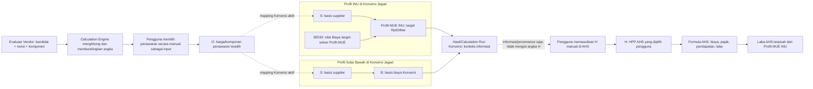

# Inventaris formula dan dependensi Evaluasi Vendor → Konversi Jagad → AHS

Revisi 8 — 14 Oktober 2026, diselaraskan dengan PRD v1.7-draft dan referensi SOP Procurement Proyek Tonasa. **F:** [AHAS Sistem.xlsx](AHAS%20Sistem.xlsx) diperiksa langsung dari workspace v4. SHA-256 `4235dc6a0d837a7bf5fe2e50d7c5684c4653b619179eefc1608b53ff33a8ec55`. Dua sheet terlihat: `AHAS INU` (86 formula, 182 edge) dan `AHAS Solar bawah` (81 formula, 177 edge). Total **167 formula dan 359 referensi langsung**, dengan rentang SUM diperluas dan shared formula digeser relatif ke sel pemakainya. Tidak ada named range, external-link file, formula lintas sheet, atau siklus pada graf formula yang diperiksa. Cached value dibaca sebagai data sumber, bukan hasil kalkulasi ulang Excel saat audit ini.

**R** = kebutuhan pengguna; **F** = fakta workbook; **U** = usulan aplikasi; **K** = keputusan bisnis yang masih terbuka. MVP memakai satu jenis pengguna, tanpa role PIC. Alamat sel pada dokumen adalah provenance, bukan ID runtime. Register mapping dan K1–K9 otoritatif ada di [SPESIFIKASI_WORKSHEET_v1.7.md](SPESIFIKASI_WORKSHEET_v1.7.md). Lampiran bagian 7 memuat seluruh formula dan referensi langsung, sehingga jalur lengkap dapat ditelusuri tanpa menebak dari diagram ringkas.

**Aturan operasional [R] yang dikonfirmasi:** sistem menghitung harga/komponen dan menampilkan perbandingan angka. Kelayakan vendor, kelengkapan dokumen, dan penerapan SOP Procurement diputuskan tim di luar sistem. Pengguna memilih penawaran secara manual sebagai input Konversi Jagad, lalu menetapkan harga dasar HPP AHS sendiri berdasarkan hasil Konversi. H adalah input manual terpisah; `I16=D30` dan `I15=D29` tetap fakta formula workbook, bukan auto-binding operasional. Profit MUE Solar Bawah tidak aktif untuk perhitungan bisnis.

## 0.1 Batas scope SOP Procurement

SOP Procurement Proyek Tonasa adalah pedoman proses kerja tim di luar aplikasi. Aplikasi tidak mengimplementasikan checklist, scoring, status kelayakan, atau alur evaluasi SOP. SOP tidak menambah formula atau dependency edge pada graf perhitungan workbook.

## 1. Graf sumber dan register bukti

### 1.1 INU — formula asli

**F:** C31 PPN tidak masuk C38. Tidak ada edge C30→D30. Total C36/D36 bukan input HPP atau Gross Profit MUE. Nama AHS `K4=C9` berbeda dari nama supplier `C27=D9`; keduanya bukan bukti pilihan vendor oleh tim. C34 konversi manual 200 dan D14 OAT penawaran manual 200 adalah node terpisah walaupun nilainya sama.

### 1.2 Solar Bawah — formula asli

**F:** C34 tidak masuk C37. Tidak ada harga kandidat→C29. C9 dan C29 sama-sama 18000 pada contoh, tetapi C29 adalah formula konstanta. Total C35/D35 tidak menjadi HPP. Nama AHS `K3=C8` dan supplier `C26=D8` berbeda. Cached Profit MUE sumber −35.1 dengan margin C37=0 adalah bukti hasil tersimpan, bukan persetujuan perlakuan pajak negatif.

| ID bukti | Formula/input F yang dipertahankan | Makna keterlacakan |
|---|---|---|
| F-I1 | D10 input AKR; C30=D10 | Harga kandidat→basis supplier INU sudah ada |
| F-I2 | D30 input 21880; I16=D30 | Fakta formula sumber saja: D30→I16; pada aplikasi, nilai HPP AHS ditentukan pengguna secara manual, terpisah dari B |
| F-I3 | C38=D30-C30-C32-C33-C34; C39=D30*0.25%; C40=C38-C39; C41=C40*22%; C42=C40-C41 | Cabang Profit MUE INU |
| F-S1 | C9:E9 input; C29=18000 | Basis Solar belum mengambil kandidat |
| F-S2 | D29=C29; I15=D29 | Fakta formula sumber saja: D29→I15; pada aplikasi, HPP AHS ditentukan pengguna secara manual, bukan auto-binding B→H |
| F-S3 | C37=D29-C29-C31-C32-C33; C38=D29*0.25%; C39=C37-C38; C40=C39*22%; C41=C39-C40 | Cabang formula sumber Solar; disimpan untuk audit saja, tidak dipakai sebagai metrik operasional |
| F-A | Harga jual, volume, I×J, total biaya, selisih PPN dan laba pada bagian 2–4 | AHS dua profil; tidak ada edge laba AHS↔Profit MUE |

## 2. Inventaris lengkap menurut kelompok formula

Rentang dengan pola `K16:K33 = I×J` berarti **setiap sel** pada rentang mempunyai formula relatif sesuai barisnya. Pola `J17:J33 = J(baris−1)` juga mencakup semua anggota *shared formula*. Input manual/konstanta dicatat ketika menjadi akar dependensi. Tidak ada formula lain di workbook di luar kelompok berikut.

| Kelompok | F: AHAS INU | F: AHAS Solar bawah |
|---|---|---|
| Nama/konteks terhubung | `K4=C9`; `K5=C26`; `K6=C18` (C18 kosong); `C27=D9` | `K3=C8`; `K4=C25`; `K5=C17` (C17 kosong); `C26=D8` |
| Harga dasar penawaran | `C10=19900` konstanta formula; `D10=20000` input; `E10=0` input | `C9=18000`, `D9=18500`, `E9=0` input |
| PPN penawaran | `C11:E11 = C10:E10 × 11%` per kolom | `C10:E10 = C9:E9 × 11%` per kolom |
| Pajak dan OAT penawaran | `D12=D10×7.5%`; `D13=D10×0.3%`; `C15=C14×11%`; `D15=D14×11%`. `C12:C14`, `D14`, `E12:E13` input; `C16` input. | `C14=C13×11%`; `D14=D13×11%`. `C11:E12`, `C13:D13`, `C15` input. Tidak ada formula PBBKB/PPH penawaran Solar. |
| Total penawaran | `C17=SUM(C10:C16)`; `D17=SUM(D10:D15)`; `E17=SUM(E10:E16)` | `C16=SUM(C9:C15)`; `D16=SUM(D9:D14)`; `E16=SUM(E9:E15)` |
| Basis konversi | `C30=D10`; `D30=21880` input manual | `C29=18000` formula konstanta; `D29=C29` |
| Pajak/komponen konversi | `C31=C30×11%`; `D31=D30×11%`; `C32=C30×7.5%`; `C33=C30×0.3%`; `C34=200` input; `C35=C34×11%` | `C30=C29×11%`; `D30=D29×11%`; `C31:C34` input nol |
| Total konversi | `C36=SUM(C30:C35)`; `D36=SUM(D30:D35)` | `C35=SUM(C29:C34)`; `D35=SUM(D29:D34)` |
| Gross/net/Profit MUE | `C38=D30−C30−C32−C33−C34`; `C39=D30×0.25%`; `C40=C38−C39`; `C41=C40×22%`; `C42=C40−C41` | `C37=D29−C29−C31−C32−C33`; `C38=D29×0.25%`; `C39=C37−C38`; `C40=C39×22%`; `C41=C39−C40` |
| Harga jual dan pajak | `I11=25900/1.11`; `I12=I11×7.5%×0`; `I13=I11×11%`; `J8=SUM(I11:I13)`; `L10=SUM(I11:I13)` | `I10=25900/1.11`; `I11=I10×7.5%×0`; `I12=I10×11%`; `J7=SUM(I10:I12)`; `L9=SUM(I10:I12)` |
| Volume dan pendapatan jual | `J11=50000` input; `J12=J11`, `J13=J12`; `K11:K13 = I(baris)×J(baris)`; `L9=L10×J11` | `J10=50000` input; `J11=J10`, `J12=J11`; `K10:K12 = I(baris)×J(baris)`; `L8=L9×J10` |
| Tarif HPP dan pajak beli | `I16=D30`; `I17=I15×7.5%×0`; `I18=I16×7.5%×0`; `I21=I16×11%` | `I15=D29`; `I16=I14×7.5%×0`; `I17=I15×7.5%×0`; `I20=I15×11%` |
| Kuantitas/amount biaya | `J16=J11`; `J17:J33=J(baris−1)`; `K16:K33=I(baris)×J(baris)` | `J15=J10`; `J16:J32=J(baris−1)`; `K15:K32=I(baris)×J(baris)` |
| Agregat dan laba AHS | `L14=SUM(K16:K33)`; `L15=SUM(I16:I33)`; `L34=L9−L14`; `L35=K13−K21`; `L36=L34−L35`; `L37=L36/J11`; `L38=L36/L14` | `L13=SUM(K15:K32)`; `L14=SUM(I15:I32)`; `L33=L8−L13`; `L34=K12−K20`; `L35=L33−L34`; `L36=L35/J10`; `L37=L35/L13` |

**F:** `SUM` Excel melewati sel kosong. Contoh `D17`/`D16` berakhir sebelum baris BPH; ini bukan izin untuk menambahkan BPH pada versi dinamis. `I17` INU dan `I16` Solar berlabel OAT tetapi merujuk sel header kosong `I15`/`I14`; tidak boleh diam-diam mengubah basis menjadi HPP. Label persentase pada biaya manual nol tidak membuktikan rumus persentasenya aktif.

## 3. Seluruh komponen biaya AHS

**F:** tiap amount `K` adalah tarif `I` dikali volume `J` pada barisnya. Input manual pada tabel di bawah bukan formula, kecuali yang dinyatakan di atas. Harga dan label dari gambar lain tidak menggantikan workbook ini.

| Komponen sumber | INU `I/K` | Solar `I/K` | Sumber tarif F |
|---|---|---|---|
| HPP Harga Dasar | 16 | 15 | Basis biaya konversi `D30` / `D29` |
| HPP OAT | 17 | 16 | Formula basis header kosong × 7.5% × 0 |
| HPP PBBKB | 18 | 17 | HPP dasar × 7.5% × 0 |
| HPP PPH INU 0,3% | 19 | 18 | Input 0 |
| HPP BPH Migas 0,25% | 20 | 19 | Input 0 |
| PAJAK PPN 11% | 21 | 20 | HPP dasar × 11% |
| PAJAK PPH penjualan BUMN 1,5% | 22 | 21 | Input 0 |
| COST OF FUND Investor | 23 | 22 | Input 0 |
| COST OF FUND Bunga Bank | 24 | 23 | Input 0 |
| COST OF FUND Diskonto SKBDN 3,3% | 25 | 24 | Input 0 |
| OPERASIONAL Biaya Operasional | 26 | 25 | Input 0 |
| OPERASIONAL Bonus Marketing | 27 | 26 | Input 50 |
| ASET Tangki Solar | 28 | 27 | Input 0 |
| KOORDINASI Ormas/Lainnya | 29 | 28 | Input 0 |
| RELASI Biaya Proyek | 30 | 29 | Input 200 |
| RELASI Biaya Mediator | 31 | 30 | Input 250 |
| RESIKO Biaya Resiko / Biaya Keagenan | 32 | 31 | INU input 0 / Solar input 100 |
| RESIKO Kenaikan Harga | 33 | 32 | Input 0 |

## 4. Graf perhitungan AHS yang dipertahankan

Diagram memakai pasangan alamat INU / Solar. Semua edge adalah F; tabel bagian 2 dan lampiran memberikan formula persis tiap sel.

Node RATE merangkum seluruh tarif, termasuk HPP/pajak/input biaya; bukan input tambahan. Persentase akhir memakai denominator total biaya, bukan pendapatan. J8 INU/J7 Solar menduplikasi SUM harga include untuk tampilan. K4:K6 INU/K3:K5 Solar dan C27/C26 adalah relasi metadata, tetap dicatat di inventaris. Harga keekonomian H7/H6, lokasi evaluasi D7/D6, tanggal, termin dan periode tidak mempunyai edge angka ke laba yang ditemukan. Hubungan metadata baru harus diberi label U, bukan ditambahkan sebagai fakta sumber.

## 5. Graf aplikasi yang direkomendasikan — mapping U/K

Garis putus-putus pada graf aplikasi menunjukkan relasi konteks/mapping operasional, bukan formula asli. H AHS dimasukkan manual oleh pengguna setelah melihat hasil Konversi; tidak ada edge numerik otomatis B→H. Alias O/S/B/H serta status target-solver INU dijelaskan dalam spesifikasi. Formula Profit MUE Solar Bawah dipertahankan hanya di inventaris formula sumber, bukan dihitung sebagai metrik operasional.

**R/U:** dua subgraph adalah profil dalam satu worksheet Konversi, bukan dua workspace. Target Profit MUE aktif hanya untuk INU. Formula Profit MUE Solar Bawah tetap ada di inventaris sumber demi audit, tetapi tidak dihitung sebagai metrik bisnis operasional. H AHS adalah input manual yang ditetapkan pengguna setelah melihat Calculation Run Konversi; hubungan putus-putus ke H berarti konteks/provenance, bukan transfer nilai otomatis.

**R/U:** D30/B INU ditentukan melalui pencarian nilai yang memenuhi target Profit MUE memakai formula aktif, dengan presisi/step dan batas pencarian yang harus dikonfigurasi; tidak menggunakan delta dari selisih angka contoh. Setelah hasil Konversi diketahui, pengguna memasukkan HPP AHS secara terpisah. Solar Bawah tidak mengaktifkan kalkulasi Profit MUE secara operasional.

## 6. Dampak, pembatasan, dan keterlacakan uji

| Perubahan | Jalur yang dihitung ulang | Batas/status | Uji |
|---|---|---|---|
| D10 pada sumber INU | C30, pajak/total supplier, C38:C42 serta total penawaran AKR | D30/I16/laba AHS tidak berubah numerik | T03, T11 |
| C9:E9 pada sumber Solar | Pajak/total penawaran terkait | C29/D29/I15 tidak berubah | T03 |
| O terpilih untuk INU | O→S; target-solver menentukan B/D30→Profit MUE INU; HPP AHS manual | Validasi formula, presisi/step, batas pencarian; hasil konversi tidak mengisi H | T04–T06, T19 |
| O operasional INU + M-IM | S→MUE; penawaran | B/H tetap numerik, hasil perlu review sampai basis manual dikonfirmasi | T06, T11 |
| O terpilih untuk Solar Bawah | O→S→B dalam Konversi sesuai mapping; HPP AHS manual | Konstanta C29 tetap sebagai fakta sumber; Profit MUE Solar tidak operasional | T04–T06 |
| Pemilihan vendor oleh tim | Ranking harga dan input penawaran membantu keputusan; O mengikat kandidat/revisi pilihan tim | Tidak ada auto-award; H manual tidak berubah otomatis | T01, T05, T20, T22 |
| Kandidat tidak terpilih | Penawaran kandidat tersebut | AHS hanya berubah jika custom reference eksplisit | T12 |
| Formula/anggota total | Writer dan graf target→seluruh turunan | Validasi unit, missing ref, konflik writer dan siklus lebih dahulu | T07, T13–T15 |
| Reset/ganti profil | Aktifkan default/state target dan invalidasi cache terkait | Profil lain utuh; reset yang memutus mapping menghasilkan WAITING_MAPPING | T08–T10 |

**F:** tidak ditemukan faktor liter↔kg/ton atau aturan profit sharing. Tidak ada hubungan laba AHS→Profit MUE atau volume→Profit MUE pada formula sumber. **K:** makna satuan MUE dan pajak atas margin negatif perlu keputusan. Tarif 11%, 7.5%, 0.3%, 0.25%, 22%, pembagi 1.11, dan faktor nol adalah fakta formula contoh; audit ini tidak menyatakan kebijakan pajak yang berlaku.

## 7. Lampiran seluruh formula dan referensi langsung — F

Daftar berikut diekstrak dari XML workbook. Teks formula dipertahankan termasuk kapitalisasi SUM/sum; anggota shared formula diekspansi relatif. Kolom referensi mengembangkan rentang menjadi sel individual dan menghitung satu edge per pasangan sumber→target. Blank yang direferensikan tetap dicatat, bukan dihapus dari graf. Total 167 baris formula dan 359 edge diverifikasi terhadap workbook; tabel bukan hasil uji aplikasi.

### AHAS INU

| Sel | Formula asli setelah ekspansi shared formula | Referensi langsung |
|---|---|---|
| `K4` | `=C9` | `C9` |
| `K5` | `=C26` | `C26` |
| `K6` | `=C18` | `C18` |
| `J8` | `=sum(I11:I13)` | `I11`, `I12`, `I13` |
| `L9` | `=L10*J11` | `L10`, `J11` |
| `C10` | `=19900` | Tidak ada (konstanta) |
| `L10` | `=SUM(I11:I13)` | `I11`, `I12`, `I13` |
| `C11` | `=C10*11%` | `C10` |
| `D11` | `=D10*11%` | `D10` |
| `E11` | `=E10*11%` | `E10` |
| `I11` | `=25900/1.11` | Tidak ada (konstanta) |
| `K11` | `=I11*J11` | `I11`, `J11` |
| `D12` | `=D10*7.5%` | `D10` |
| `I12` | `=I11*7.5%*0` | `I11` |
| `J12` | `=J11` | `J11` |
| `K12` | `=I12*J12` | `I12`, `J12` |
| `D13` | `=D10*0.3%` | `D10` |
| `I13` | `=I11*11%` | `I11` |
| `J13` | `=J12` | `J12` |
| `K13` | `=I13*J13` | `I13`, `J13` |
| `L14` | `=sum(K16:K33)` | `K16`, `K17`, `K18`, `K19`, `K20`, `K21`, `K22`, `K23`, `K24`, `K25`, `K26`, `K27`, `K28`, `K29`, `K30`, `K31`, `K32`, `K33` |
| `C15` | `=C14*11%` | `C14` |
| `D15` | `=D14*11%` | `D14` |
| `L15` | `=sum(I16:I33)` | `I16`, `I17`, `I18`, `I19`, `I20`, `I21`, `I22`, `I23`, `I24`, `I25`, `I26`, `I27`, `I28`, `I29`, `I30`, `I31`, `I32`, `I33` |
| `I16` | `=D30` | `D30` |
| `J16` | `=J11` | `J11` |
| `K16` | `=I16*J16` | `I16`, `J16` |
| `C17` | `=sum(C10:C16)` | `C10`, `C11`, `C12`, `C13`, `C14`, `C15`, `C16` |
| `D17` | `=sum(D10:D15)` | `D10`, `D11`, `D12`, `D13`, `D14`, `D15` |
| `E17` | `=SUM(E10:E16)` | `E10`, `E11`, `E12`, `E13`, `E14`, `E15`, `E16` |
| `I17` | `=I15*7.5%*0` | `I15` |
| `J17` | `=J16` | `J16` |
| `K17` | `=I17*J17` | `I17`, `J17` |
| `I18` | `=I16*7.5%*0` | `I16` |
| `J18` | `=J17` | `J17` |
| `K18` | `=I18*J18` | `I18`, `J18` |
| `J19` | `=J18` | `J18` |
| `K19` | `=I19*J19` | `I19`, `J19` |
| `J20` | `=J19` | `J19` |
| `K20` | `=I20*J20` | `I20`, `J20` |
| `I21` | `=I16*11%` | `I16` |
| `J21` | `=J20` | `J20` |
| `K21` | `=I21*J21` | `I21`, `J21` |
| `J22` | `=J21` | `J21` |
| `K22` | `=I22*J22` | `I22`, `J22` |
| `J23` | `=J22` | `J22` |
| `K23` | `=I23*J23` | `I23`, `J23` |
| `J24` | `=J23` | `J23` |
| `K24` | `=I24*J24` | `I24`, `J24` |
| `J25` | `=J24` | `J24` |
| `K25` | `=I25*J25` | `I25`, `J25` |
| `J26` | `=J25` | `J25` |
| `K26` | `=I26*J26` | `I26`, `J26` |
| `C27` | `=D9` | `D9` |
| `J27` | `=J26` | `J26` |
| `K27` | `=I27*J27` | `I27`, `J27` |
| `J28` | `=J27` | `J27` |
| `K28` | `=I28*J28` | `I28`, `J28` |
| `J29` | `=J28` | `J28` |
| `K29` | `=I29*J29` | `I29`, `J29` |
| `C30` | `=D10` | `D10` |
| `J30` | `=J29` | `J29` |
| `K30` | `=I30*J30` | `I30`, `J30` |
| `C31` | `=C30*11%` | `C30` |
| `D31` | `=D30*11%` | `D30` |
| `J31` | `=J30` | `J30` |
| `K31` | `=I31*J31` | `I31`, `J31` |
| `C32` | `=C30*7.5%` | `C30` |
| `J32` | `=J31` | `J31` |
| `K32` | `=I32*J32` | `I32`, `J32` |
| `C33` | `=C30*0.3%` | `C30` |
| `J33` | `=J32` | `J32` |
| `K33` | `=I33*J33` | `I33`, `J33` |
| `L34` | `=L9-L14` | `L9`, `L14` |
| `C35` | `=C34*11%` | `C34` |
| `L35` | `=K13-K21` | `K13`, `K21` |
| `C36` | `=SUM(C30:C35)` | `C30`, `C31`, `C32`, `C33`, `C34`, `C35` |
| `D36` | `=SUM(D30:D35)` | `D30`, `D31`, `D32`, `D33`, `D34`, `D35` |
| `L36` | `=L34-L35` | `L34`, `L35` |
| `L37` | `=L36/J11` | `J11`, `L36` |
| `C38` | `=D30-C30-C32-C33-C34` | `C30`, `D30`, `C32`, `C33`, `C34` |
| `L38` | `=L36/L14` | `L14`, `L36` |
| `C39` | `=D30*0.25%` | `D30` |
| `C40` | `=C38-C39` | `C38`, `C39` |
| `C41` | `=C40*22%` | `C40` |
| `C42` | `=C40-C41` | `C40`, `C41` |

### AHAS Solar bawah

| Sel | Formula asli setelah ekspansi shared formula | Referensi langsung |
|---|---|---|
| `K3` | `=C8` | `C8` |
| `K4` | `=C25` | `C25` |
| `K5` | `=C17` | `C17` |
| `J7` | `=sum(I10:I12)` | `I10`, `I11`, `I12` |
| `L8` | `=L9*J10` | `L9`, `J10` |
| `L9` | `=SUM(I10:I12)` | `I10`, `I11`, `I12` |
| `C10` | `=C9*11%` | `C9` |
| `D10` | `=D9*11%` | `D9` |
| `E10` | `=E9*11%` | `E9` |
| `I10` | `=25900/1.11` | Tidak ada (konstanta) |
| `K10` | `=I10*J10` | `I10`, `J10` |
| `I11` | `=I10*7.5%*0` | `I10` |
| `J11` | `=J10` | `J10` |
| `K11` | `=I11*J11` | `I11`, `J11` |
| `I12` | `=I10*11%` | `I10` |
| `J12` | `=J11` | `J11` |
| `K12` | `=I12*J12` | `I12`, `J12` |
| `L13` | `=sum(K15:K32)` | `K15`, `K16`, `K17`, `K18`, `K19`, `K20`, `K21`, `K22`, `K23`, `K24`, `K25`, `K26`, `K27`, `K28`, `K29`, `K30`, `K31`, `K32` |
| `C14` | `=C13*11%` | `C13` |
| `D14` | `=D13*11%` | `D13` |
| `L14` | `=sum(I15:I32)` | `I15`, `I16`, `I17`, `I18`, `I19`, `I20`, `I21`, `I22`, `I23`, `I24`, `I25`, `I26`, `I27`, `I28`, `I29`, `I30`, `I31`, `I32` |
| `I15` | `=D29` | `D29` |
| `J15` | `=J10` | `J10` |
| `K15` | `=I15*J15` | `I15`, `J15` |
| `C16` | `=sum(C9:C15)` | `C9`, `C10`, `C11`, `C12`, `C13`, `C14`, `C15` |
| `D16` | `=sum(D9:D14)` | `D9`, `D10`, `D11`, `D12`, `D13`, `D14` |
| `E16` | `=SUM(E9:E15)` | `E9`, `E10`, `E11`, `E12`, `E13`, `E14`, `E15` |
| `I16` | `=I14*7.5%*0` | `I14` |
| `J16` | `=J15` | `J15` |
| `K16` | `=I16*J16` | `I16`, `J16` |
| `I17` | `=I15*7.5%*0` | `I15` |
| `J17` | `=J16` | `J16` |
| `K17` | `=I17*J17` | `I17`, `J17` |
| `J18` | `=J17` | `J17` |
| `K18` | `=I18*J18` | `I18`, `J18` |
| `J19` | `=J18` | `J18` |
| `K19` | `=I19*J19` | `I19`, `J19` |
| `I20` | `=I15*11%` | `I15` |
| `J20` | `=J19` | `J19` |
| `K20` | `=I20*J20` | `I20`, `J20` |
| `J21` | `=J20` | `J20` |
| `K21` | `=I21*J21` | `I21`, `J21` |
| `J22` | `=J21` | `J21` |
| `K22` | `=I22*J22` | `I22`, `J22` |
| `J23` | `=J22` | `J22` |
| `K23` | `=I23*J23` | `I23`, `J23` |
| `J24` | `=J23` | `J23` |
| `K24` | `=I24*J24` | `I24`, `J24` |
| `J25` | `=J24` | `J24` |
| `K25` | `=I25*J25` | `I25`, `J25` |
| `C26` | `=D8` | `D8` |
| `J26` | `=J25` | `J25` |
| `K26` | `=I26*J26` | `I26`, `J26` |
| `J27` | `=J26` | `J26` |
| `K27` | `=I27*J27` | `I27`, `J27` |
| `J28` | `=J27` | `J27` |
| `K28` | `=I28*J28` | `I28`, `J28` |
| `C29` | `=18000` | Tidak ada (konstanta) |
| `D29` | `=C29` | `C29` |
| `J29` | `=J28` | `J28` |
| `K29` | `=I29*J29` | `I29`, `J29` |
| `C30` | `=C29*11%` | `C29` |
| `D30` | `=D29*11%` | `D29` |
| `J30` | `=J29` | `J29` |
| `K30` | `=I30*J30` | `I30`, `J30` |
| `J31` | `=J30` | `J30` |
| `K31` | `=I31*J31` | `I31`, `J31` |
| `J32` | `=J31` | `J31` |
| `K32` | `=I32*J32` | `I32`, `J32` |
| `L33` | `=L8-L13` | `L8`, `L13` |
| `L34` | `=K12-K20` | `K12`, `K20` |
| `C35` | `=SUM(C29:C34)` | `C29`, `C30`, `C31`, `C32`, `C33`, `C34` |
| `D35` | `=SUM(D29:D34)` | `D29`, `D30`, `D31`, `D32`, `D33`, `D34` |
| `L35` | `=L33-L34` | `L33`, `L34` |
| `L36` | `=L35/J10` | `J10`, `L35` |
| `C37` | `=D29-C29-C31-C32-C33` | `C29`, `D29`, `C31`, `C32`, `C33` |
| `L37` | `=L35/L13` | `L13`, `L35` |
| `C38` | `=D29*0.25%` | `D29` |
| `C39` | `=C37-C38` | `C37`, `C38` |
| `C40` | `=C39*22%` | `C39` |
| `C41` | `=C39-C40` | `C39`, `C40` |
