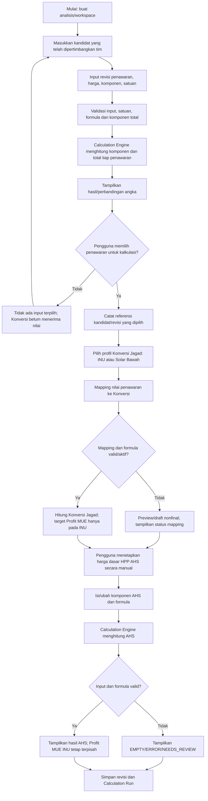

# Flowchart proses bisnis — Evaluasi Vendor (kalkulasi), Konversi Jagad, dan AHS

Revisi 8 — 14 Oktober 2026. Diselaraskan dengan PRD v1.7-draft. Dokumen rancangan; implementasi dan acceptance test aplikasi belum dilakukan.

## Batas tanggung jawab

- Tim menentukan vendor yang layak dimasukkan dan dipertimbangkan berdasarkan SOP Procurement di luar sistem.
- Sistem tidak memeriksa dokumen, menilai delapan aspek SOP, memberi status kelayakan, membuat skor, atau merekomendasikan vendor.
- Sistem hanya menghitung angka dari input/formula, menampilkan hasil perbandingan, dan membiarkan pengguna memilih penawaran secara manual sebagai input ke Konversi.
- Setelah melihat hasil Konversi Jagad, pengguna menentukan sendiri harga dasar HPP AHS.

## 1. Alur utama

## 2. Perilaku saat ada perubahan

| Perubahan | Perilaku sistem |
|---|---|
| Harga/komponen/revisi penawaran | Hitung ulang hasil penawaran yang terdampak dan perbarui perbandingan. Pilihan input tidak diganti otomatis. |
| Pengguna memilih penawaran lain | Perbarui referensi input O dan hitung ulang Konversi yang terkait. |
| Mapping atau profil Konversi berubah | Hitung ulang dependensi Konversi; jangan mengubah HPP AHS secara otomatis. |
| Harga dasar HPP AHS berubah | Hitung ulang node AHS yang bergantung pada H. |
| Formula atau input tidak valid | Tampilkan error/status nonfinal; jangan mengarang nilai pengganti. |
| Kelayakan vendor/dokumen/SOP | Ditangani oleh tim di luar sistem; tidak ada checklist atau status kelayakan di aplikasi. |

## 3. Ringkasan tiga worksheet

| Worksheet | Tugas aplikasi | Tanggung jawab manusia di luar/di dalam aplikasi |
|---|---|---|
| Evaluasi Vendor | Menyimpan kandidat/revisi, menghitung komponen/total berdasarkan formula, menampilkan perbandingan harga. | Tim menentukan kandidat mana yang layak; pengguna memilih penawaran secara manual sebagai input. |
| Konversi Satuan Jagad | Mengambil penawaran yang dipilih lewat mapping; menghitung profil INU atau Solar Bawah. | Pengguna menetapkan/mengaktifkan mapping sesuai aturan bisnis yang telah diputuskan. |
| AHS | Menghitung AHS dari formula, biaya, dan harga dasar HPP yang diinput. | Pengguna menentukan harga dasar HPP sendiri setelah meninjau hasil Konversi. |

## 4. Fakta sumber yang tetap diaudit

- INU: `C30=D10`; `D30` adalah input manual pada workbook sumber; `I16=D30` merupakan hubungan formula sumber, bukan binding otomatis yang wajib dipakai aplikasi.
- Solar Bawah: `C29=18000`; `D29=C29`; `I15=D29` merupakan fakta workbook sumber. Aplikasi tidak memakai angka contoh sebagai default proyek baru.
- Profit MUE INU memakai target aktual `50,00 ≤ Profit MUE < 51,00` sesuai requirement yang dikonfirmasi; presisi/step dan batas pencarian masih harus dikonfigurasi.
- Profit MUE Solar Bawah tidak digunakan sebagai kalkulasi operasional.
- HPP AHS (`H`) adalah input manual independen; tidak otomatis disalin dari `S` atau `B`.

## 5. Bukan scope sistem

Evaluasi kualitatif vendor, validasi dokumen/perizinan, penilaian aspek SOP Procurement, negosiasi, approval manajemen, PO, kesiapan H-2, aktivasi vendor cadangan, pelaksanaan bunker, penerimaan, pembayaran, penagihan, dan scoring kelayakan tidak termasuk MVP kalkulasi ini. SOP Procurement Proyek Tonasa adalah pedoman kerja tim, bukan rule engine aplikasi.
