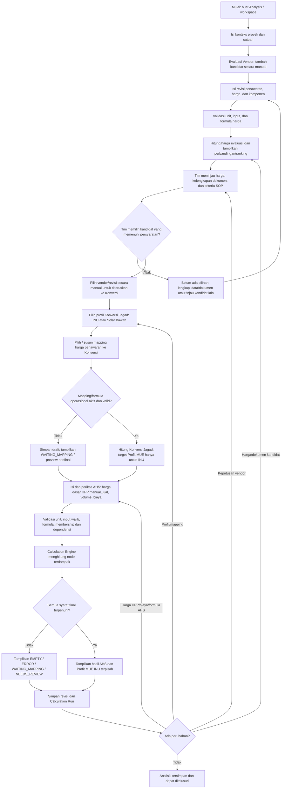
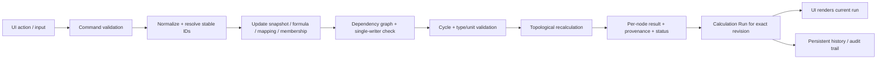

# Product Requirements Document (PRD)
# Sistem Evaluasi Vendor → Konversi Satuan Jagad → Analisis Harga Satuan (AHS)

**Versi:** 1.7-draft  
**Tanggal:** 14 Oktober 2026  
**Status:** Draft PRD dan implementation plan. Sistem difokuskan pada perhitungan harga/komponen vendor, perhitungan Konversi Jagad, dan perhitungan AHS. Kelayakan vendor untuk dimasukkan ke analisis dan keputusan vendor dilakukan oleh tim/pengguna di luar penilaian otomatis sistem. MVP menggunakan satu jenis pengguna tanpa role terpisah seperti Procurement, PIC, Reviewer, atau Approver dan tanpa role-based access control; keputusan bisnis yang belum dikonfirmasi tetap berstatus draft.  
**Tujuan dokumen:** Menjadi sumber acuan utama untuk desain, implementasi, pengujian, dan review sistem.  
**Prinsip penting:** Jangan mengubah rekomendasi teknis menjadi aturan bisnis yang dianggap sudah disahkan.

**Catatan versi 1.7:** Memperjelas batas scope setelah konfirmasi pengguna: kelayakan memasukkan vendor, pemeriksaan dokumen, penerapan SOP, dan keputusan vendor merupakan tanggung jawab tim di luar sistem. Sistem tidak membuat checklist kelayakan vendor, skor kepatuhan SOP, status lulus/gagal, atau rekomendasi vendor. Pengguna memasukkan kandidat yang sudah dipertimbangkan tim; sistem menghitung komponen/total sesuai formula yang dikonfigurasi, menampilkan perbandingan harga, dan memungkinkan pengguna memilih penawaran secara manual untuk diteruskan ke Konversi. Sistem tetap menghitung Konversi Jagad dan AHS, dengan harga dasar HPP AHS ditetapkan manual oleh pengguna.

**Catatan versi 1.5:** Sistem tidak memilih vendor otomatis; keputusan vendor berada pada tim/pengguna. Pada versi 1.7 dipertegas bahwa penilaian kelayakan vendor dan kepatuhan SOP sepenuhnya di luar scope sistem.

---

## 0. Cara membaca dokumen ini

Dokumen menggunakan label berikut agar kebutuhan, fakta sumber, dan asumsi tidak tercampur:

- **[R] Requirement:** kebutuhan produk yang ditetapkan dari kebutuhan pengguna. Aturan target Profit MUE INU pada bagian 6.3.1 merupakan aturan yang sudah dikonfirmasi pengguna.
- **[F] Source fact:** fakta yang ditemukan pada workbook `AHAS Sistem.xlsx`.
- **[U] Proposal:** keputusan desain/teknis yang direkomendasikan untuk aplikasi, tetapi belum otomatis menjadi kebijakan bisnis.
- **[K] Keputusan bisnis terbuka:** keputusan aturan operasional yang belum ditetapkan. Untuk MVP, pengguna yang sama dapat menetapkannya; tidak ada role PIC atau alur persetujuan antar-role.
- **[MVP]** wajib masuk versi awal.
- **[Later]** di luar MVP awal dan dapat direncanakan kemudian.

### Dokumen sumber dan batas audit

PRD ini disusun berdasarkan tiga dokumen review:

1. `FLOWCHART_PROSES_BISNIS_v1.7.md`
2. `FLOWCHART_PERHITUNGAN_AHS_v1.7.md`
3. `SPESIFIKASI_WORKSHEET_v1.7.md`
4. `SOP Procurement Proyek Tonasa.pdf` (sumber kriteria evaluasi vendor dan tahapan operasional proyek Tonasa)

**Catatan sumber SOP Procurement:** `SOP Procurement Proyek Tonasa.pdf` tersedia sebagai referensi proses kerja tim. SOP mengatur evaluasi dan kelayakan vendor oleh tim, tetapi sistem ini tidak mengimplementasikan proses evaluasi kualitatif tersebut. SOP tidak menjadi dasar untuk membuat checklist, skor, atau status kelayakan otomatis di aplikasi. Aplikasi hanya menghitung angka dari input/formula yang ditetapkan pengguna. Keputusan memasukkan kandidat dan memilih penawaran dilakukan manusia di luar kalkulasi sistem.

Workbook sumber bernama `AHAS Sistem.xlsx`, dengan dua sheet: `AHAS INU` dan `AHAS Solar bawah`. Audit formula menyatakan ada **167 formula dan 359 referensi formula langsung** dalam struktur yang diperiksa. Audit tersebut membaca formula dan cached values; belum melakukan recalculation melalui Excel, belum mengesahkan kebijakan pajak/bisnis, dan tidak berarti sistem aplikasi telah diuji.

**Catatan visual:** dokumen sumber menyebut `image.png` belum ditemukan di workspace v4 yang diaudit. Karena pengguna menyatakan gambar telah disediakan, implementasi harus memverifikasi lokasi aktualnya sebelum UI final dianggap memenuhi referensi visual. Jangan mengklaim UI sudah sesuai gambar sebelum gambar ditemukan dan diperiksa.

---

# 1. Ringkasan eksekutif

## 1.1 Gambaran produk

Sistem ini adalah satu workspace analisis procurement yang menghubungkan tiga worksheet dinamis:

1. **Evaluasi Vendor** — pengguna memasukkan beberapa vendor/kandidat secara manual, mengisi harga penawaran dan komponennya, melihat perhitungan, serta membandingkan penawaran.
2. **Konversi Satuan Jagad** — pengguna membawa harga dari penawaran terpilih ke basis konversi melalui mapping yang eksplisit. Di dalam tabel ini terdapat dua profil formula independen: **Solar INU** dan **Solar Bawah**.
3. **Analisis Harga Satuan (AHS)** — setelah meninjau hasil Konversi Jagad, pengguna menentukan sendiri harga dasar HPP untuk AHS dan memasukkannya secara eksplisit. Nilai H tersebut tidak otomatis disamakan dengan B atau S. Mesin formula kemudian menghitung biaya, pajak, pendapatan, dan laba AHS berdasarkan H yang dipilih pengguna.

Ketiganya bukan aplikasi terpisah dan bukan tiga file yang tidak saling terhubung. Ketiganya adalah tiga tabel dalam satu analisis dengan relasi data dan formula yang bisa ditelusuri.

## 1.2 Alur bisnis inti dalam satu kalimat

**Buat analisis → masukkan kandidat yang sudah dipertimbangkan tim → masukkan harga dan komponen → sistem menghitung formula dan menampilkan perbandingan angka → pengguna memilih penawaran secara manual → penawaran pilihan diteruskan ke Konversi Satuan Jagad → hitung Konversi Jagad → pengguna menentukan harga dasar HPP AHS → hitung AHS dan simpan revisi.**

## 1.3 Masalah yang diselesaikan

- Harga vendor, komponen biaya, konversi, dan AHS berisiko dikelola terpisah sehingga sumber angka tidak jelas.
- Sistem membantu menghitung komponen/total harga kandidat dan menampilkan perbandingan angka berdasarkan formula yang dikonfigurasi. Kelayakan vendor, pemeriksaan dokumen, kepatuhan SOP, serta alasan bisnis memilih vendor menjadi tanggung jawab tim di luar sistem. Pengguna memilih penawaran secara manual hanya untuk menentukan data yang diteruskan ke Konversi Jagad.
- Rumus workbook perlu dipertahankan sebagai default yang dapat diaudit, tetapi aplikasi membutuhkan relasi operasional lintas tabel yang tidak seluruhnya tersedia di workbook sumber.
- Perubahan harga dapat memengaruhi sebagian atau seluruh hasil. Sistem harus menghitung ulang dependensi yang terdampak dan menandai hasil yang hasilnya perlu ditinjau kembali oleh pengguna.
- Semua tabel harus terasa seperti workbook/worksheet yang bisa diedit, bukan dashboard statis. Namun, UI tidak boleh menyimpan logika aritmetika bisnisnya sendiri.
- Pengguna harus bisa menambahkan/mengubah baris, kolom, rumus, dan anggota agregat tanpa merusak hubungan data karena sort atau perubahan posisi.
- Hasil lama harus dapat direproduksi dari revisi input, formula, mapping, profil, dan keputusan yang sama.

## 1.4 Prinsip produk

1. **Satu analisis, tiga worksheet inti.** Jangan memecah INU dan Solar Bawah menjadi dua workspace terpisah.
2. **Vendor dimasukkan manual.** Tidak diperlukan master vendor global untuk MVP; daftar kandidat dapat berbeda per proyek/lokasi.
3. **Keputusan vendor oleh tim, didukung perhitungan sistem.** Sistem menghitung dan membandingkan harga serta menampilkan peringkat, catatan penawaran, dan kriteria SOP. Tim memilih kandidat yang memenuhi persyaratan; harga termurah bukan satu-satunya penentu. Sistem tidak memilih vendor secara otomatis. Jika tidak ada kandidat yang memenuhi persyaratan wajib, tampilkan bahwa belum ada vendor yang dapat dipilih.
4. **Sumber angka terlacak.** Setiap angka penting dapat menunjukkan sumber, formula, mapping, dan revisinya.
5. **Default formula bukan kebenaran kebijakan.** Formula sumber dipertahankan sebagai bukti; override operasional harus terpisah dan memiliki versi.
6. **Satu target, satu penulis aktif.** Target formula tidak boleh ditulis bersamaan oleh formula default, override, input manual, dan mapping tanpa aturan prioritas yang eksplisit.
7. **Tidak ada angka pengganti diam-diam.** Input kosong bukan nol; missing reference bukan nol; harga yang belum dipetakan bukan berarti mengambil kandidat pertama.
8. **Tidak ada faktor bisnis yang diada-adakan.** Faktor konversi fisik, pajak, biaya, atau profit sharing hanya boleh diaktifkan setelah ada sumber/keputusan bisnis atau pilihan pengguna.
9. **Perubahan menghasilkan revisi.** Reset/restore tidak menghapus sejarah; membuat versi baru.
10. **Kalkulasi deterministik dan terpisah dari UI.** UI menampilkan hasil Calculation Engine, bukan menghitung bisnis sendiri.

---

# 2. Tujuan, indikator keberhasilan, dan batas produk

## 2.1 Tujuan produk

- [MVP] Menyatukan evaluasi vendor, Konversi Jagad, dan AHS dalam satu workspace.
- [MVP] Mengalirkan penawaran vendor terpilih ke Konversi Jagad melalui mapping yang eksplisit, lalu menyediakan hasil konversi sebagai dasar informasi bagi pengguna untuk menetapkan harga HPP AHS secara mandiri.
- [MVP] Mempertahankan struktur dan formula default dari workbook INU dan Solar Bawah sebagai paket yang bisa ditinjau/dipulihkan.
- [MVP] Membuat seluruh tabel dinamis dan dapat menghitung otomatis dengan mesin formula bersama.
- [MVP] Menyimpan revisi serta asal perubahan agar hasil dapat diaudit dan dibandingkan.
- [MVP] Mencegah hasil berstatus final ketika data, mapping, formula, unit, atau keputusan bisnis yang diperlukan belum ditetapkan.
- [MVP] Menyediakan alur perubahan harga dan recalculation tanpa menimpa histori hasil sebelumnya.

## 2.2 Indikator keberhasilan penerimaan MVP

Indikator berikut merupakan target penerimaan, bukan statistik penggunaan yang sudah tersedia:

- 100% dari 24 kelompok skenario penerimaan T01–T24 lulus sebelum MVP diserahkan.
- Kandidat terpilih, revisi penawaran, profil, mapping, dan versi formula bisa ditelusuri dari hasil AHS.
- Tidak ada perubahan sort/urut baris yang memindahkan referensi formula ke data yang salah.
- Formula yang berubah menghasilkan revisi formula dan penilaian ulang dependensinya.
- Hasil pada snapshot yang sama konsisten antara kalkulasi penuh dan kalkulasi incremental.
- Sistem menolak/memblokir status final saat mapping wajib belum ditetapkan/diaktifkan, input wajib kosong, ada error, atau keputusan sudah perlu ditinjau.
- Reset/restore dapat mengembalikan default formula tanpa menghapus input yang harus dipertahankan dan tanpa menampilkan angka contoh sebagai input proyek baru.

**Catatan scope pengguna MVP:** hanya ada satu jenis pengguna tanpa role Procurement/PIC/Reviewer/Approver. Pengguna yang sama mengerjakan seluruh proses. Tidak ada RBAC atau workflow approval antar-role. Histori perubahan, validasi, status draft/aktif/perlu ditinjau, dan pencatatan keputusan bisnis tetap wajib.

## 2.3 Bukan tujuan MVP

- **[Out of scope]** Mengelola master vendor global dengan sinkronisasi eksternal.
- **[Out of scope]** Mengambil harga pasar atau memperbarui harga vendor otomatis dari API.
- **[Out of scope]** Evaluasi kualitatif kelayakan vendor, checklist dokumen/perizinan, penilaian kepatuhan SOP, scoring, rekomendasi vendor, auto-award, dan workflow keputusan procurement. Tim memutuskan vendor di luar sistem; aplikasi hanya menghitung harga/komponen dan memungkinkan pengguna memilih penawaran yang akan dipakai sebagai input Konversi.
- **[Out of scope]** Menetapkan pajak, faktor konversi fisik, basis satuan, atau profit sharing tanpa keputusan bisnis atau pilihan pengguna.
- **[Out of scope]** Membangun spreadsheet engine selengkap Microsoft Excel/Google Sheets (macro, VBA, arbitrary code, plugin formula, semua fungsi Excel).
- **[Out of scope]** Menyamakan Profit MUE dengan laba AHS, menjumlahkan keduanya, atau membuat pembagian profit baru tanpa bukti.
- **[Out of scope]** Memasukkan angka contoh dari workbook sebagai nilai awal proyek produksi.
- **[Out of scope]** Menjadikan cached values workbook sebagai hasil kalkulasi tervalidasi.
- **[Out of scope MVP / Later]** Role-based access control, role Procurement/PIC/Reviewer/Approver, approval antar-role/bertingkat, tanda tangan digital, notifikasi email/WhatsApp, integrasi ERP/akuntansi, dan pelaporan lintas proyek.

---

# 3. Model pengguna MVP

MVP tidak memerlukan role Procurement, PIC, Analyst, Reviewer, Approver, atau Administrator yang terpisah. Sistem menggunakan **satu jenis pengguna** yang dapat menjalankan seluruh aktivitas di workspace.

| Jenis pengguna | Kemampuan pada MVP | Batasan sistem |
|---|---|---|
| **Pengguna workspace** | Membuat analisis; memasukkan kandidat dan revisi penawaran; mengubah tabel/input/formula; memeriksa hasil; memilih konfigurasi/mapping yang tersedia; mengaktifkan konfigurasi setelah validasi; menyimpan dan meninjau histori. | Sistem tetap memblokir atau memberi status peringatan pada data, formula, unit, dan mapping yang tidak valid. Pengguna tidak dapat mengubah histori lama secara diam-diam; koreksi menghasilkan revisi baru. |

**Batas scope MVP:** tidak ada role-based access control, pemisahan hak edit/review/approval, approval bertingkat, atau routing keputusan berdasarkan jabatan. Status seperti `DRAFT`, `ACTIVE`, dan `NEEDS_REVIEW` menunjukkan keadaan konfigurasi/hasil, bukan peran atau persetujuan antarorang. Keputusan bisnis yang belum jelas tetap dicatat sebagai terbuka dan tidak boleh disimpulkan otomatis oleh sistem.

Authentication, multi-user access, dan permission per-role dapat dipertimbangkan pada fase berikutnya bila kebutuhan pengguna berkembang. Jangan mendesain alur utama MVP bergantung pada fitur tersebut.

---

# 4. Model domain: entitas dan istilah inti

## 4.1 Empat alias harga yang wajib dibedakan

| Alias | Definisi | Sumber atau target |
|---|---|---|
| **O — Selected Offer Price** | Harga/komponen dari kandidat dan revisi penawaran yang dipilih manual oleh pengguna. Kandidat sudah dipertimbangkan/dianggap layak oleh tim di luar sistem. Sistem menghitung nilai berdasarkan formula yang dikonfigurasi; hasil hitung bukan penilaian kelayakan vendor dan tidak memilih vendor otomatis. | Evaluasi Vendor |
| **S — Supplier Base** | Basis harga supplier pada profil Konversi Jagad. | Konversi Jagad |
| **B — Conversion Cost Base** | Basis biaya dalam profil Konversi Jagad. Bisa berasal dari mapping aktif/valid atau input manual jika keputusan bisnis menetapkannya demikian. | Konversi Jagad |
| **H — AHS HPP Base** | Harga dasar HPP yang ditentukan dan dimasukkan sendiri oleh pengguna setelah meninjau hasil Konversi Jagad. Nilai ini merupakan input AHS tersendiri; tidak otomatis disalin dari S atau B. | AHS |

Keempat alias harus direpresentasikan oleh node/field dengan **ID stabil**, bukan dengan alamat Excel A1 atau nomor posisi baris. Meskipun nilai O/S/B/H sama, keempatnya tetap node yang berbeda dan memiliki provenance berbeda.

### Aturan operasional HPP AHS yang sudah dikonfirmasi pengguna [R]

Urutan operasional adalah **input kandidat yang telah dipertimbangkan tim → perhitungan harga oleh sistem → pengguna memilih penawaran secara manual → Konversi Satuan Jagad → penetapan harga dasar HPP AHS oleh pengguna → perhitungan AHS**. Sistem tidak menilai kelayakan vendor, memeriksa dokumen SOP, atau memberi keputusan procurement. Setelah meninjau hasil Konversi (termasuk target Profit MUE INU bila profil INU digunakan), pengguna menentukan dan mengisi nilai H sebagai harga dasar HPP AHS.

- H adalah input manual independen di AHS; tidak ada auto-binding `H=B` atau `H=S` pada perilaku operasional default.
- H mencatat candidate ID, offer revision, profil Konversi, dan Calculation Run yang menjadi konteks keputusan pengguna. Nilai tersebut merupakan provenance, bukan formula yang mengisi H.
- Perubahan vendor, revisi penawaran, profil, mapping, atau hasil Konversi tidak menimpa H secara otomatis. Sistem menandai konteks H/AHS `NEEDS_REVIEW` sampai pengguna meninjau dan memutuskan apakah H perlu diperbarui.
- Jika H belum diisi, hasil AHS yang bergantung pada H tetap `EMPTY`/nonfinal. Nilai contoh workbook tidak boleh menjadi fallback.
- Fakta workbook `I16=D30` dan `I15=D29` tetap dipertahankan untuk audit sumber, tetapi tidak memaksa aplikasi menjalankan hubungan operasional otomatis tersebut.

## 4.2 Konsep data minimum

- **Analysis:** satu ruang kerja/analisis; punya ID, judul, proyek, lokasi/tujuan bila relevan, satuan, revision, status, dan tiga tabel inti.
- **Candidate:** satu vendor/penawaran kandidat yang diinput manual di dalam analisis.
- **Offer Revision:** snapshot penawaran pada waktu tertentu; memuat angka, komponen, unit, tanggal, catatan, dan sumber dokumen jika ada. Sistem tidak menentukan kelengkapan/kelayakan dokumen.
- **Offer Value:** nilai per komponen di dalam revisi penawaran, dengan ID, jenis nilai, unit, formula/input, dan source reference.
- **SelectedOfferReference:** referensi kandidat dan revisi penawaran yang dipilih manual pengguna sebagai input untuk Konversi. Sistem menyimpan ID penawaran dan snapshot formula/hasil kalkulasi terkait; tidak menyimpan checklist kelayakan SOP atau alasan penilaian kualitatif vendor.
- **Conversion Profile:** profil formula INU atau Solar Bawah yang aktif. Masing-masing menyimpan input, formula override, mapping, keputusan, dan freshness sendiri.
- **Mapping Version:** hubungan dari source node ke target node (mis. O→S), termasuk transformasi, unit, scope, status `DRAFT`/`ACTIVE`/`REJECTED`/`NEEDS_REVIEW`, pembuat/peristiwa perubahan bila tersedia, dan versi.
- **Worksheet/Table/Row/Column/Cell Node:** struktur worksheet yang bisa diubah; identitasnya tidak bergantung pada posisi tampilan.
- **Aggregate + Membership:** daftar node anggota yang eksplisit untuk SUM/total tertentu; sort dan penambahan baris tidak boleh secara otomatis menambah anggota kecuali tindakan pengguna/aturan menyatakan begitu.
- **Source Formula:** formula default yang diambil dari workbook, tidak diubah saat pengguna mengedit formula aplikasi.
- **Formula Override:** formula versi aplikasi yang mengganti formula default untuk target tertentu setelah validasi dan aktivasi eksplisit oleh pengguna.
- **Calculation Run:** hasil perhitungan satu snapshot revisi data/formula/mapping/profil/engine; menyimpan nilai, status, error, dan provenance per node.
- **Change Event:** catatan perubahan data/struktur/pilihan/mapping/formula/reset/restore.
- **Business Decision:** catatan keputusan/konfigurasi pengguna untuk mapping, formula atau aturan tertentu; harus menunjuk ke versi yang dipilih dan menyimpan alasan/sumber bila relevan.

## 4.3 Prinsip sumber kebenaran

- Workbook merupakan sumber bukti bagi formula/struktur awal; bukan sumber aturan baru yang tidak tertulis.
- Penawaran vendor adalah sumber bagi O, tetapi hanya dari Candidate + Offer Revision yang dipilih secara manual oleh tim dan dicatat melalui pengguna workspace.
- Mapping aktif dan valid adalah sumber relasi lintas worksheet.
- Calculation Engine adalah satu-satunya sumber hasil hitung aplikasi.
- Calculation Run adalah bukti hasil historis untuk snapshot tertentu.
- UI tidak menjadi sumber kebenaran angka; UI hanya mengedit input/struktur/aturan dan menampilkan hasil mesin.

---

# 5. Alur utama end-to-end

## 5.1 Flowchart utama



## 5.2 Penjelasan langkah bisnis

### Langkah 1 — Buat workspace/analysis

Pengguna membuat satu analisis dengan ID unik dan konteks minimum seperti nama proyek, lokasi/tujuan, tanggal analisis, penyusun, dan satuan yang sedang digunakan. Field konteks selain ID dan satuan wajib boleh dikonfigurasi; jangan menambahkan kewajiban bisnis baru tanpa kebutuhan.

Workspace otomatis menyediakan tiga tabel inti: Evaluasi Vendor, Konversi Satuan Jagad, dan AHS. Workspace baru tidak membawa harga, volume, vendor, atau input contoh dari workbook. Yang dibawa dari workbook hanya definisi formula/layout default yang telah dimodelkan dan diberi label provenance.

### Langkah 2 — Input kandidat dan penawaran

Pengguna menambahkan satu atau banyak vendor secara manual. Satu kandidat dapat memiliki beberapa revisi penawaran sepanjang waktu. Setiap revisi menyimpan harga dan komponen yang eksplisit, satuan, sumber/tanggal penawaran jika ada, serta catatan input yang relevan untuk kalkulasi. Status kelayakan vendor/dokumen tidak dikelola sistem.

Sistem boleh menghitung subtotal/total dari komponen yang dipilih sebagai anggota agregat, tetapi tidak boleh memutuskan sendiri bahwa semua kolom biaya masuk ke total. Membership komponen total harus terlihat dan bisa diedit secara terkendali. Komponen yang dikosongkan tidak otomatis dianggap nol.

### Langkah 3 — Perhitungan harga dan pemilihan input secara manual

Sistem menghitung harga/komponen dari kandidat yang dimasukkan pengguna berdasarkan formula yang dikonfigurasi, memvalidasi input numerik, satuan, dan dependensi, lalu menampilkan hasil per kandidat. Sistem dapat menampilkan perbandingan angka, tetapi tidak menyimpulkan kelayakan vendor, tidak memeriksa kelengkapan dokumen, tidak menilai delapan aspek SOP, dan tidak memberikan rekomendasi procurement.

Tim bertanggung jawab menentukan vendor mana yang layak dimasukkan dan dipertimbangkan berdasarkan SOP Procurement yang berlaku. Setelah keputusan manusia dibuat di luar kalkulasi sistem, pengguna memilih kandidat dan revisi penawaran secara manual di workspace agar nilai penawaran yang dipilih dapat diteruskan ke Konversi Jagad. Pilihan manual ini adalah pemilihan input untuk kalkulasi, bukan approval workflow atau modul penilaian vendor. Jika tidak ada penawaran yang dipilih, sistem tidak meneruskan harga ke Konversi.

SOP Procurement Proyek Tonasa tetap menjadi referensi proses kerja tim, bukan aturan kelayakan otomatis di aplikasi. Dokumen, izin, keamanan, armada/stok, target H+3, aspek Finance/Market/Harga & Profit/Perizinan/Waktu, negosiasi SPH, dan kesiapan vendor diperiksa oleh tim di luar scope sistem. Sistem tidak membuat checklist atau status `COMPLIANT`/`NON_COMPLIANT` untuk aspek-aspek tersebut.

### Langkah 4 — Pilih profil Konversi Jagad

Pengguna memilih salah satu profil formula: INU atau Solar Bawah. Kedua profil berada pada worksheet Konversi Jagad yang sama, namun input, formula override, mapping, keputusan, dan histori masing-masing tetap independen. Berpindah profil tidak menghapus state profil lain.

### Langkah 5 — Alur O→Konversi Jagad; H AHS ditetapkan pengguna

Sistem mengambil nilai O dari kandidat dan revisi penawaran yang dipilih pengguna secara manual sebagai input kalkulasi, lalu meneruskannya ke profil Konversi Jagad melalui mapping yang berlaku. Mapping harus menyebutkan source node, target node, komponen harga asal, transformasi, unit, cakupan, status `DRAFT`/`ACTIVE`/`NEEDS_REVIEW`, serta versi. Hubungan otomatis ke Konversi tidak berarti harga dasar HPP AHS ikut tersalin otomatis.

**Tidak ada mapping usulan yang boleh otomatis dianggap aktif.** Jika mapping wajib belum dikonfigurasi atau diaktifkan pengguna, sistem boleh menunjukkan preview dengan label yang jelas, tetapi harus menampilkan `WAITING_MAPPING` untuk hasil final yang bergantung padanya.

### Langkah 6 — Hitung Konversi Jagad

Setelah input, mapping, formula, dan unit lolos validasi, Calculation Engine menghitung node yang relevan dan cabang Profit MUE. Profit MUE ditampilkan dan disimpan sebagai hasil tersendiri, tidak digabung dengan laba AHS.

### Langkah 7 — Tetapkan harga dasar HPP dan lengkapi AHS

Setelah meninjau hasil dari Konversi Jagad, pengguna menentukan sendiri nilai H (harga dasar HPP AHS) dan memasukkannya sebagai input manual yang eksplisit. Sistem menyimpan nilai H bersama sumber konteksnya—kandidat dan revisi penawaran terpilih, profil, serta Calculation Run Konversi yang dijadikan acuan. Tidak ada assignment otomatis `H=B` atau `H=S`. Pengguna kemudian mengisi atau menyesuaikan harga jual, volume, dan komponen biaya AHS. Mesin menghitung AHS dari nilai H yang benar-benar ditetapkan pengguna.

### Langkah 8 — Validasi dan kalkulasi

Mesin memvalidasi referensi, status input, tipe/satuan, formula, dependency graph, konflik writer, siklus, dan membership agregat. Mesin menghitung node terdampak sesuai urutan dependency. Run harus terikat ke revision snapshot yang tepat.

### Langkah 9 — Review, simpan, dan keputusan

Sistem menunjukkan output, status final/nonfinal, provenance, error, mapping/formula yang digunakan, serta keputusan bisnis yang masih perlu ditinjau. Pengguna dapat mengaktifkan konfigurasi yang lolos validasi dan menyimpan revisi hasil beserta Calculation Run; kegagalan simpan harus terlihat jelas.

### Langkah 10 — Perubahan setelah analisis tersimpan

Perubahan data input, revisi penawaran, pemilihan, mapping, formula, membership, profil, atau struktur menciptakan revisi baru. Dependensi terdampak dihitung ulang. Harga yang berubah setelah keputusan bisnis atau pilihan pengguna tidak boleh menimpa keputusan lama; keputusan lama tetap menunjuk revisi yang dahulu ditinjau. Keadaan terbaru diberi `NEEDS_REVIEW` sampai pengguna meninjau versi baru sesuai kebijakan.

---

# 6. Functional requirements

## 6.1 Workspace dan lifecycle analysis

| ID | Requirement | Prioritas | Acceptance criteria |
|---|---|---|---|
| FR-001 | Sistem menyediakan satu workspace dengan tiga tabel inti terhubung. | MVP | Pengguna dapat berpindah antartabel tanpa membuat workspace baru. |
| FR-002 | Setiap workspace punya stable ID dan revision. | MVP | Perubahan menghasilkan revisi baru; ID tidak berubah ketika nama/urutan berubah. |
| FR-003 | Workspace baru tidak memakai input contoh sebagai data operasional. | MVP | Harga/volume contoh workbook tidak terisi sebagai nilai pengguna pada workspace baru. |
| FR-004 | Workspace menyimpan status analisis dan kelengkapan. | MVP | Status `DRAFT`/`NEEDS_REVIEW`/`READY` ditampilkan terpisah dari status formula; MVP tidak memiliki workflow approval berbasis role. |
| FR-005 | Workspace dapat disalin sebagai draft tanpa berbagi ID/revisi histori dengan sumber. | Later | Duplikasi membentuk ID baru dan menautkan sumber duplikasi bila diperlukan. |

## 6.2 Evaluasi Vendor

| ID | Requirement | Prioritas | Acceptance criteria |
|---|---|---|---|
| FR-010 | Pengguna dapat menambah, mengubah, dan menonaktifkan kandidat vendor secara manual pada analisis. | MVP | Kandidat tidak memerlukan master global. |
| FR-011 | Kandidat mendukung satu atau lebih revisi penawaran. | MVP | Perubahan harga membuat Offer Revision baru; nilai revisi sebelumnya tetap terbaca. |
| FR-012 | Setiap komponen penawaran punya stable ID, label, jenis nilai, satuan, dan status input/formula. | MVP | Rename/urut ulang tidak mengubah target referensi. |
| FR-013 | Pengguna dapat mengatur formula komponen/total dan keanggotaan agregat secara eksplisit. | MVP | Total hanya menjumlah anggota yang terdaftar; membership dapat ditinjau. |
| FR-014 | Sistem menampilkan input, formula, hasil, unit, sumber, dan status pada setiap sel yang relevan. | MVP | User dapat mengidentifikasi nilai manual vs formula. |
| FR-015 | Sistem menghitung harga/komponen penawaran dan menampilkan perbandingan angka. | MVP | Sistem tidak menilai kelayakan vendor, memeriksa checklist SOP, atau memberi rekomendasi procurement. |
| FR-016 | Pengguna dapat memilih kandidat/revisi penawaran secara manual sebagai sumber input Konversi Jagad. | MVP | Sistem menyimpan ID kandidat/revisi yang dipilih serta provenance hasil hitung; penilaian kelayakan dan alasan bisnis pemilihan dilakukan di luar sistem. Pilihan tidak berubah otomatis saat harga berubah. |
| FR-017 | Total penawaran all-in tidak otomatis dipakai sebagai O/S/B/H. | MVP | Mapping menyebutkan komponen sumber yang digunakan; all-in diblokir bila komposisinya tidak jelas. |
| FR-018 | Jika harga berubah setelah selection, versi lama tetap dapat direproduksi dan versi terbaru memicu review. | MVP | Snapshot/hasil lama tidak berubah diam-diam; hasil current menjadi `NEEDS_REVIEW` saat perubahan memengaruhi perhitungan atau keputusan bisnis terbuka. |
| FR-019 | Pemeriksaan kelayakan vendor dan penerapan SOP Procurement berada di luar scope aplikasi. | Out of scope | Tim menilai kelayakan vendor dan kelengkapan dokumen; sistem hanya menghitung angka dari input/formula pengguna. |
| FR-019A | SOP Procurement Tonasa menjadi referensi kerja manusia, bukan mesin kelayakan vendor di aplikasi. | Out of scope | Tidak ada penilaian status, checklist, atau scoring aspek SOP di dalam aplikasi. |
| FR-019B | Modul checklist kelayakan vendor dan dokumen penagihan customer tidak dibangun pada MVP. | Out of scope | Dokumen tersebut dikelola sesuai proses bisnis tim di luar sistem kalkulasi. |

## 6.3 Konversi Satuan Jagad

| ID | Requirement | Prioritas | Acceptance criteria |
|---|---|---|---|
| FR-020 | Konversi Jagad memiliki profil INU dan Solar Bawah dalam satu worksheet. | MVP | Switch profil tidak membuat workspace baru. |
| FR-021 | State input, override formula, mapping, dan histori tiap profil disimpan terpisah. | MVP | Perubahan INU tidak merusak state Solar Bawah dan sebaliknya. |
| FR-022 | Aplikasi menyediakan default formula sumber yang ditandai dengan sumber sheet/sel/versi. | MVP | Formula sumber bisa ditinjau meski override aktif. |
| FR-023 | Aplikasi memisahkan formula sumber, formula override aplikasi, dan mapping lintas worksheet. | MVP | User dapat melihat lapisan mana yang menentukan hasil target. |
| FR-024 | Mapping O→S untuk INU/Solar Bawah disimpan sebagai versi yang memiliki scope dan unit. | MVP | Mapping dengan unit atau scope tidak cocok diblokir dari hasil final. |
| FR-025 | Harga dasar HPP AHS (H) ditentukan secara manual oleh pengguna setelah meninjau hasil Konversi Jagad. | MVP | H menyimpan nilai yang dipilih pengguna dan referensi konteks konversi; sistem tidak otomatis mengisi H=B atau H=S. Jika H belum diisi, perhitungan AHS yang bergantung padanya tidak boleh berstatus final. |
| FR-026 | Profil INU harus menghitung rekomendasi nilai Biaya (B/D30) yang memenuhi target Profit MUE terkonfirmasi memakai formula aktif dan konfigurasi presisi/step serta batas pencarian yang tersedia. | MVP | Jangan gunakan `B=S+ΔINU` sebagai asumsi default dan jangan mengambil delta dari selisih angka contoh; jika target tidak dapat dipenuhi atau parameter pencarian belum tersedia, tampilkan `TARGET_NOT_REACHED`/status konfigurasi yang sesuai. |
| FR-027 | Profil Solar Bawah meneruskan harga pilihan ke Konversi Jagad melalui mapping S=O; B mengikuti aturan konversi aktif yang dikonfigurasi, tetapi H AHS tetap diinput sendiri oleh pengguna. | MVP | Konstanta sumber C29=18000 tetap disimpan untuk audit; Profit MUE Solar Bawah tidak digunakan secara operasional. |
| FR-028 | Total penawaran bukan HPP otomatis; sistem menunjukkan peringatan atas potensi double-tax basis. | MVP | Harga all-in tidak masuk basis HPP kecuali komposisi dan aturan telah ditetapkan. |
| FR-029 | Tidak ada konversi fisik satuan otomatis tanpa faktor dan unit yang dikonfigurasi dan divalidasi. | MVP | Unit mismatch mencegah hasil final. |
| FR-030 | Profit MUE tetap terpisah dari laba AHS. | MVP | Tidak ada total/profit sharing gabungan otomatis. |
| FR-031 | Untuk profil INU, sistem menyediakan penentuan/penyesuaian nilai Biaya (`D30` pada formula sumber) berdasarkan target Profit MUE. Target ideal adalah tepat Rp50,00; nilai aktual yang diterima harus memenuhi `50,00 ≤ Profit MUE < 51,00`. | MVP | Sistem menghitung ulang dengan formula aktif dan komponen input terkini; nilai di bawah Rp50,00 atau ≥ Rp51,00 ditolak. Tidak boleh mengubah formula/komponen lain diam-diam untuk memaksa target. |
| FR-032 | Penentuan nilai Biaya untuk target Profit MUE hanya berlaku pada profil INU yang menggunakan cabang Profit MUE operasional. | MVP | Fitur target tidak aktif untuk Solar Bawah; blok Profit MUE Solar Bawah diberi status non-operasional sesuai requirement pengguna. |

### 6.3.1 Aturan target Profit MUE untuk profil INU [R — dikonfirmasi pengguna]

Aturan ini berasal dari penjelasan operasional pengguna, bukan disimpulkan dari formula workbook.

- Target ideal Profit MUE adalah **tepat Rp50,00** per unit sesuai satuan output yang berlaku pada workbook.
- Hasil yang dapat diterima adalah **`50,00 ≤ Profit MUE < 51,00`**. Hasil `49,99` atau lebih rendah tidak diterima; hasil `51,00` atau lebih tinggi juga tidak diterima.
- Sistem harus berusaha mencari nilai Biaya (`D30` pada source workbook) yang membuat Profit MUE tepat Rp50,00. Jika target tepat tidak dapat dicapai pada presisi/input-step yang diizinkan, sistem boleh memilih hasil valid dalam rentang tersebut yang paling dekat ke Rp50,00.
- Validasi dilakukan pada **nilai numerik aktual**, bukan hanya teks tampilan yang dibulatkan. Pembulatan tampilan tidak boleh menyamarkan hasil aktual di luar rentang.
- Sistem harus menggunakan formula Profit MUE aktif dan nilai input terkini, lalu menghitung ulang dependensi setiap kandidat nilai Biaya. Jangan mengubah tarif, harga vendor, komponen biaya, atau formula lain secara diam-diam untuk mencapai target.
- Nilai Biaya yang dihasilkan harus ditampilkan sebagai **rekomendasi perhitungan** dan dapat ditelusuri: input yang digunakan, formula/versi formula, target, nilai Biaya kandidat, hasil Profit MUE aktual, presisi/step, serta status validasi. Perubahan nilai otomatis tidak boleh menghapus histori atau menggantikan keputusan lama.
- Bila tidak ditemukan nilai yang memenuhi rentang, batas pencarian belum ditentukan, formula tidak valid, atau input wajib kosong, sistem tidak boleh mengarang angka. Tampilkan `TARGET_NOT_REACHED` atau status error yang sesuai dan minta pengguna meninjau input/konfigurasi.
- Fitur ini berlaku untuk **INU saja**. Solar Bawah tidak menggunakan blok Gross Profit, BPH Migas, Net Margin, PPh, Profit MUE, dan Crosscheck sebagai kalkulasi operasional.

**Catatan implementasi:** presisi nilai Biaya, langkah perubahan (misalnya bilangan bulat atau desimal), batas pencarian yang diizinkan, serta aturan pembulatan akuntansi masih harus ditetapkan pada konfigurasi/K4. Jangan mengasumsikan nilai Biaya boleh memiliki desimal tanpa keputusan tersebut. Algoritme harus menghitung ulang formula aktif untuk setiap kandidat dan tidak boleh mengandalkan nilai cached workbook.

**Contoh acceptance fixture** (hanya untuk memeriksa implementasi terhadap angka contoh workbook, bukan sebagai input default proyek baru): dengan `C30=20000`, `C32=1500`, `C33=60`, `C34=200`, dan formula sumber yang tercantum pada bagian 7.3, `D30=21879` menghasilkan Profit MUE sekitar `50,156`, `D30=21880` sekitar `50,934`, `D30=21878` sekitar `49,378`, dan `D30=21881` sekitar `51,712`. Karena itu, dengan langkah input Rp1, Rp21.879 dan Rp21.880 lolos rentang, sedangkan Rp21.878 dan Rp21.881 tidak. Nilai-nilai ini hanya fixture pengujian; workspace baru tetap kosong.

## 6.4 AHS

| ID | Requirement | Prioritas | Acceptance criteria |
|---|---|---|---|
| FR-040 | AHS memiliki default struktur dan formula berdasarkan workbook sumber untuk INU/Solar Bawah. | MVP | Tiap formula membawa provenance sheet/sel; source default tidak rusak ketika override ada. |
| FR-041 | HPP AHS menggunakan nilai H yang dimasukkan sendiri oleh pengguna berdasarkan hasil Konversi Jagad yang ditinjau. | MVP | Perubahan harga vendor atau hasil konversi tidak menimpa H secara otomatis; sistem mencatat run konversi yang dijadikan konteks dan menandai H/hasil AHS `NEEDS_REVIEW` bila konteks tersebut berubah. |
| FR-042 | Harga jual dan volume dapat diubah sebagai input, bukan dianggap permanen dari contoh workbook. | MVP | Workspace baru tidak mewarisi nilai jual/volume contoh sebagai data proyek. |
| FR-043 | Biaya AHS mendukung tipe nilai setidaknya: per-unit, fixed-total, percent-based, manual amount, dan formula amount. | MVP, rincian butuh K7 | Perhitungan menggunakan tipe yang dikonfigurasi dan divalidasi; tipe tidak diketahui ditandai NEEDS_REVIEW. |
| FR-044 | Total biaya hanya memakai anggota yang eksplisit. | MVP | Menambahkan baris tidak otomatis mengubah total kecuali membership diatur. |
| FR-045 | Sistem mempertahankan kalkulasi total biaya, pendapatan, PPN selisih, laba kotor/bersih dan rasio sesuai formula default. | MVP | Hasil default dapat ditelusuri ke formula source; operasional final menunggu validasi K4. |
| FR-046 | Perhitungan per unit tidak dilakukan bila volume kosong/nol atau basis satuan tidak valid. | MVP | Hasil terkait menampilkan EMPTY/ERROR, bukan angka infinity atau nol yang tampak valid. |
| FR-047 | Laba AHS dan Profit MUE ditampilkan sebagai output berbeda dengan provenance masing-masing. | MVP | Tidak ada penggabungan keduanya. |

## 6.5 Worksheet/table builder

| ID | Requirement | Prioritas | Acceptance criteria |
|---|---|---|---|
| FR-050 | Setiap tabel memungkinkan penambahan/edit baris dan kolom dengan kontrol yang sesuai. | MVP | Struktur dapat diperluas tanpa mengubah ID node existing. |
| FR-051 | Kolom/sell mendukung nilai manual, formula, label teks, unit, hasil hitung, atau reference node sesuai tipe. | MVP | Tipe data terlihat; tidak semua kolom dianggap angka. |
| FR-052 | Drag/reorder/sort/filter tidak mengubah formula target karena dependency menggunakan stable ID. | MVP | Sort data yang sama tidak mengubah hasil numerik. |
| FR-053 | Pengguna dapat mengedit formula lewat formula bar/editor terbatas dan melihat preview dependensi. | MVP | Formula invalid/siklus ditolak sebelum aktif. |
| FR-054 | Pengguna bisa memulihkan formula default untuk target/baris/profil sesuai scope. | MVP | Reset membuat revision; tidak menghapus input yang perlu dipertahankan. |
| FR-055 | Hapus node yang masih direferensikan diblokir atau meminta penyelesaian dependensi eksplisit. | MVP | Sistem tidak membiarkan broken reference diam-diam. |
| FR-056 | Membership agregat diedit secara eksplisit. | MVP | Row baru tidak otomatis masuk SUM hanya karena berada di bawah baris terakhir. |
| FR-057 | Worksheet mempertahankan tampilan workbook-like dan meminimalkan deviasi layout dari `image.png` bila file tersedia. | MVP | Pemeriksaan visual dilakukan setelah sumber visual ditemukan; layout tidak mengubah perilaku formula. |

## 6.6 Formula engine dan dependency graph

| ID | Requirement | Prioritas | Acceptance criteria |
|---|---|---|---|
| FR-060 | Mesin formula terpisah dari komponen UI. | MVP | UI tidak berisi perhitungan bisnis independen. |
| FR-061 | Mesin menyimpan graf dependensi menggunakan node ID stabil. | MVP | Perubahan label/posisi tidak mengubah edge. |
| FR-062 | Mesin mendukung operator +, -, *, /, kurung, persen, SUM, referensi node dan agregat terdaftar. | MVP | Test fixtures membuktikan parsing, precedence dan evaluasi. |
| FR-063 | Mesin menolak arbitrary code/eval/function, akses global, dan formula di luar grammar yang diizinkan. | MVP | Formula berbahaya/tidak dikenal tidak dijalankan. |
| FR-064 | Mesin mendeteksi reference missing, unit mismatch, conflict writer, circular dependency dan division by zero. | MVP | Kesalahan diberi kode, lokasi/target, dan jalur dependensi bila relevan. |
| FR-065 | Satu mutation mengikuti satu pipeline validasi → update graph → cycle detection → recalculation → publish run. | MVP | Run berisi revision yang sama dengan perubahan yang dihitung. |
| FR-066 | Full recalculation dan incremental recalculation memberikan hasil identik untuk snapshot sama. | MVP | Tes perbandingan otomatis lulus. |
| FR-067 | Run lama tidak boleh menimpa hasil revisi terbaru. | MVP | Perubahan bersamaan/stale revision ditolak atau ditangani eksplisit. |
| FR-068 | Cabang independen dapat valid meskipun cabang lain error. | MVP | Error hanya merambat ke dependency yang terdampak. |
| FR-069 | Semua output memiliki provenance source formula/mapping/input/override. | MVP | Pengguna dapat membuka detail “asal nilai”. |

## 6.7 Status dan validasi

Status nilai berikut harus berbeda dari status keputusan, freshness, dan simpan:

| Status nilai | Definisi |
|---|---|
| `EMPTY` | Input wajib belum diisi. Bukan angka nol. |
| `ZERO_EXPLICIT` | Nol diberikan secara eksplisit atau hasil hitung nol; bisa valid jika aturan bisnis mengizinkan. |
| `ERROR` | Formula invalid, missing reference, unit mismatch, conflict writer, siklus, pembagian nol, atau error mesin. |
| `WAITING_MAPPING` | Mapping wajib belum diaktifkan pengguna, hilang, atau tidak sesuai scope/unit. Preview bisa terlihat tetapi bukan hasil final. |
| `VALID` | Nilai berhasil dihitung untuk revision aktif dan dependency valid. Tidak berarti keputusan bisnis yang belum ditetapkan otomatis dianggap valid. |

Status tambahan yang terpisah:

- `freshness`: `CURRENT` / `STALE`.
- `decision_status`: `CONFIRMED` / `NEEDS_REVIEW` / `DRAFT`; status mencatat konfigurasi/keputusan pengguna, bukan approval berdasarkan role.
- `business_status`: status kelengkapan/kelayakan yang ditetapkan kebijakan.
- `save_status`: `SAVED` / `UNSAVED` / `SAVE_FAILED`.
- `formula_status`: `DEFAULT` / `OVERRIDDEN` / `INVALID_DRAFT`.

Hasil hanya boleh dinyatakan **final untuk snapshot saat ini** bila input wajib lengkap, mapping aktif dan formula valid, satuan kompatibel, semua keputusan bisnis yang berdampak pada perhitungan sudah ditetapkan, tidak ada error dependency yang menghalangi hasil, selection revision pada snapshot aktif masih berlaku, Calculation Run adalah current, dan penyimpanan sukses. Angka hasil preview tidak boleh diberi status final.

## 6.8 Histori, revision, dan audit trail

| ID | Requirement | Prioritas | Acceptance criteria |
|---|---|---|---|
| FR-080 | Perubahan input, selection, offer, formula, mapping, profil, struktur, membership, reset/restore tersimpan sebagai Change Event. | MVP | Event mencatat aktor/waktu/target/aksi/sebelum-sesudah/alasan bila relevan. |
| FR-081 | Calculation Run menyimpan snapshot versi input, profil, formula, mapping, policy, engine dan hasil. | MVP | Hasil lama bisa direproduksi dari snapshot, bukan nilai terbaru. |
| FR-082 | Team selection run menunjuk ke revisi penawaran, nilai pembanding, dan versi formula/pajak yang dipakai; user review atas hasil current dicatat terpisah. | MVP | Histori selection run tidak berubah diam-diam; perubahan input memicu run baru dan hasil yang berubah ditandai NEEDS_REVIEW. |
| FR-083 | Restore/reset menghasilkan revisi baru. | MVP | Revision lama tetap tersedia dan tidak dihapus. |
| FR-084 | Gagal simpan ditampilkan; data tidak dilabeli tersimpan jika persistensi gagal. | MVP | Indikator UNSAVED/SAVE_FAILED terlihat dan aksi retry tersedia. |
| FR-085 | Perubahan dari revision usang tidak menimpa revision baru secara diam-diam. | MVP | Konflik ditolak atau ditangani dengan merge/reload eksplisit. |
| FR-086 | Retensi, mode penyimpanan, dan hak restore dikonfigurasi sesuai K8. | MVP, kebijakan menunggu | Default retensi/akses tidak diklaim disahkan jika belum diputuskan. |

---

# 7. Kebijakan formula dan mapping

## 7.1 Tiga lapisan yang tidak boleh dicampur

1. **Source Formula:** formula/konstanta default yang berasal dari workbook. Immutable di katalog default dan memiliki hash/versi serta provenance sheet/cell.
2. **Application Override:** formula/struktur yang diedit khusus pada aplikasi. Harus memiliki versi, pembuat, alasan, test status, serta aktivasi pengguna setelah validasi bila diperlukan.
3. **Operational Mapping:** edge lintas worksheet seperti O→S di Konversi Jagad. Mapping bukan formula sumber workbook kecuali relasinya benar-benar terdapat pada workbook. Harga dasar HPP H adalah input manual tersendiri yang merujuk konteks Calculation Run Konversi, bukan target mapping otomatis dari B/S.

Satu target formula hanya boleh memiliki **satu writer aktif**. Engine harus memvalidasi konflik jika sebuah target sekaligus menerima formula default, formula override, mapping, dan/atau input manual.

## 7.2 Mapping yang ditemukan/diusulkan

| ID | Profil | Mapping | Klasifikasi | Status yang aman untuk implementasi |
|---|---|---|---|---|
| M-I1 | INU | `S = O` | [U] adaptasi operasional dari fakta sumber `C30 = D10` | Boleh disediakan sebagai draft; operasional final setelah K1. |
| M-I2 | INU | `B/D30 = nilai hasil pencarian target Profit MUE` berdasarkan formula aktif dan input terkini; H ditentukan manual terpisah | [R/U] algoritme target Profit MUE dikonfirmasi; parameter pencarian masih perlu dikonfigurasi | Tidak memakai `B=S+ΔINU` sebagai asumsi; bila input/presisi/batas tidak memadai, tampilkan status yang sesuai. |
| M-IM | INU | `S = O`; nilai B dapat ditinjau/diubah manual bila pengguna memilih override terhadap rekomendasi target; H tetap input manual terpisah | [U] override eksplisit atas nilai target-solver, bukan relasi H=B | Override dicatat dalam versi dan divalidasi ulang terhadap rentang target; harga dasar HPP H tidak ikut berubah otomatis. |
| M-S1 | Solar Bawah | `S = O`; `B = S` bila mapping konversi ini diaktifkan; `H = input manual pengguna` | [U] mapping operasional untuk Konversi Jagad; H bukan bagian dari mapping ini | Konstanta sumber C29=18000 tetap untuk audit; perubahan S/B menandai konteks H/AHS `NEEDS_REVIEW` tetapi tidak menimpa H. |
| M-SX | Solar Bawah | B berbeda dari S | [U] alternatif mapping di dalam Konversi Jagad | H tetap input manual tersendiri. Tidak diaktifkan sebelum aturan dan bukti konfigurasinya tersedia. |
| M-J1 | Kedua profil | harga jual/volume editable | [U] perilaku aplikasi; default source memiliki formula harga dan input volume contoh | Data contoh tidak diisi otomatis pada analisis baru; aturan jual/pajak K4 masih dibutuhkan. |

**Jangan pernah menyimpulkan ΔINU dari selisih nilai contoh workbook**, misalnya `21880 - 20000`. Angka itu tidak membuktikan kebijakan biaya/penyesuaian dan tidak boleh dipakai sebagai default aplikasi.

## 7.3 Fakta sumber penting yang harus dipertahankan

### INU

- `D10` adalah input harga AKR; `C30 = D10` adalah basis supplier.
- `D30` merupakan input manual pada workbook; contoh cached/input yang terlihat adalah 21880, tetapi angka contoh tidak boleh menjadi nilai awal proyek baru.
- `I16 = D30` menjadikan D30 basis HPP pada workbook.
- Tidak ada edge formula `C30 → D30` pada sumber.
- Cabang Profit MUE adalah `C38 = D30 - C30 - C32 - C33 - C34`, `C39 = D30 * 0.25%`, `C40 = C38 - C39`, `C41 = C40 * 22%`, `C42 = C40 - C41`.
- C31 PPN tidak masuk ke rumus C38 berdasarkan formula yang diperiksa.
- Total konversi C36/D36 bukan sumber otomatis untuk HPP atau Gross Profit MUE.
- Aturan operasional terbaru dari pengguna: `D30` perlu ditentukan/dioptimalkan agar Profit MUE idealnya tepat Rp50,00 dan hasil aktual berada pada rentang `50,00 ≤ Profit MUE < 51,00`. Ini adalah requirement aplikasi yang dikonfirmasi pengguna; nilai contoh `D30=21880` tetap bukan default proyek baru.

### Solar Bawah

- Kandidat harga ada pada `C9:E9`.
- `C29 = 18000` adalah konstanta formula pada workbook dan `D29 = C29`; `I15 = D29` adalah basis HPP.
- Tidak ada edge formula dari kandidat `C9:E9` ke C29.
- Cabang Profit MUE adalah `C37 = D29 - C29 - C31 - C32 - C33`, `C38 = D29 * 0.25%`, `C39 = C37 - C38`, `C40 = C39 * 22%`, `C41 = C39 - C40`.
- **[R — dikonfirmasi pengguna]** Blok Gross Profit, BPH Migas, Net Margin, PPh, Profit MUE, dan Crosscheck pada Solar Bawah tidak digunakan secara operasional. Formula/sel yang masih ada dipertahankan hanya sebagai fakta audit sumber jika diperlukan; jangan jalankan blok tersebut sebagai metrik bisnis aktif atau gunakan untuk menentukan harga Solar Bawah.
- Total konversi C35/D35 bukan sumber otomatis untuk HPP.

### AHS

- Formula sumber menghitung amount biaya per baris sebagai tarif `I × J` untuk rentang biaya yang ditinjau.
- `L14/L13` adalah total amount biaya AHS INU/Solar; `L15/L14` adalah SUM tarif yang terdaftar pada sumber, bukan otomatis hasil `total_cost/volume`.
- Harga jual, input volume dan rumus turunan ada di kedua profil, namun nilai input yang ada merupakan contoh sumber.
- OAT merujuk header kosong dikalikan faktor dan nol pada formula sumber; jangan mengubah basis rujukan diam-diam.
- Ada faktor/tarif persentase dalam formula sumber (termasuk 11%, 7.5%, 0.3%, 0.25%, 22%) dan input nol; keberadaan angka ini di formula adalah fakta source, **bukan pengesahan kebijakan bisnis/pajak terbaru**.
- Tidak terdapat relasi formula antara laba AHS dan Profit MUE.

## 7.4 Default, override, dan reset

- Default formula disimpan dalam katalog immutable dengan source file hash, sheet, cell, expression, versi import, dan status verifikasi.
- Reset formula memulihkan expression default pada scope yang dipilih; tidak otomatis mereset input pengguna.
- Reset input, reset formula, reset mapping, reset profile, dan restore historical revision harus menjadi aksi berbeda.
- Sebelum reset ditampilkan ringkasan dampak/dependency dan versi yang akan dipulihkan.
- Reset selalu membuat revision dan Change Event baru.
- Bila reset menghilangkan mapping wajib, hasil menjadi `WAITING_MAPPING`, bukan mengambil kandidat atau nilai contoh lain.

---

# 8. Spesifikasi worksheet dan UI/UX

## 8.1 Prinsip visual

- UI utama berperilaku seperti workbook dengan worksheet/tabel, bukan semata-mata dashboard kartu.
- Satu header workspace menunjukkan konteks analisis, status simpan, revision aktif, dan status review.
- Navigasi/segmented tabs untuk `Evaluasi Vendor`, `Konversi Satuan Jagad`, `AHS`.
- Pada Konversi Jagad ada pengalih profil `INU` / `Solar Bawah`; kedua profil tetap satu modul dan state masing-masing terjaga.
- Tabel harus mampu menampilkan kolom teks, angka, satuan, formula, hasil, status, dan metadata sumber.
- Ada formula bar atau panel formula yang menunjukkan expression untuk cell/node terpilih, status validasi, dependency, dan source/provenance.
- Warna/status harus membantu membezakan input manual, formula default, override, mapping, nilai belum lengkap, error, dan hasil yang perlu ditinjau. Jangan hanya mengandalkan warna; sertakan label/icon/teks status.
- Jangan membangun UI yang kelihatan seperti spreadsheet tetapi secara internal memakai posisi baris sebagai ID.
- Gunakan `image.png` sebagai acuan visual setelah lokasinya dikonfirmasi; jangan memakai screenshot/referensi lama secara asumtif.

## 8.2 Layout layar yang disarankan

### A. Workspace shell

- Breadcrumb atau judul analisis.
- Nama proyek, revision, status saved/unsaved, status review.
- Navigasi tiga worksheet.
- Panel ringkasan ringan yang hanya menampilkan status dan output dari Engine; perhitungan tetap tidak dilakukan di UI.

### B. Evaluasi Vendor

- Tabel kandidat/penawaran yang mendukung banyak vendor.
- Penawaran yang dipilih pengguna sebagai input Konversi terlihat jelas; perbandingan harga tersedia sebagai hasil kalkulasi, bukan rekomendasi kelayakan.
- Formula/total per vendor dan komposisi all-in ditampilkan dengan detail dapat dibuka.
- Aksi: tambah kandidat/revisi/komponen, edit formula/komponen, bandingkan hasil kalkulasi, dan pilih penawaran secara manual sebagai input Konversi.
- Riwayat perubahan/penawaran dapat dibuka per kandidat.

### C. Konversi Satuan Jagad

- Satu worksheet dengan switch profil INU/Solar Bawah.
- Area provenance O/S/B/H dan ringkasan mapping status/version.
- Default formula source dapat dipilih untuk ditinjau.
- Formula override dapat diedit setelah validasi; draft dapat dipreview tanpa mengaktifkan formula.
- Cabang Profit MUE INU ditampilkan terpisah dengan label eksplisit, bersama target Rp50,00 dan status rentang.
- Untuk Solar Bawah, blok Profit MUE tidak ditampilkan sebagai output operasional; bila perlu untuk audit, tampilkan hanya pada panel formula sumber/non-operasional yang jelas terpisah.
- Ketika mapping belum aktif/valid, status waiting terlihat jelas, tidak disamarkan oleh angka cache/preview.

### D. AHS

- Worksheet AHS mengikuti struktur sumber sebisa mungkin dan berdasarkan visual target setelah diverifikasi.
- HPP target jelas menunjukkan sumber dari H.
- Harga jual, volume, tarif, amount, kategori/jenis biaya, dan total memiliki tipe field yang terlihat.
- Input pengguna dan hasil formula dibedakan.
- Laba AHS dan Profit MUE bukan angka gabungan.
- Error/warning pada perhitungan atau unit dapat dibuka untuk melihat penyebab/dependency.

### E. Formula editor / dependency inspector

- Editor ekspresi terbatas: angka, ID reference, +, -, *, /, persen, tanda kurung, `SUM`, agregat yang disetujui.
- Autocomplete berdasarkan label tetapi menyimpan stable node ID di ekspresi terkompilasi.
- Menampilkan dependency parent dan dependent; preview hasil/dampak sebelum commit.
- Menolak error syntax, unknown function, unknown reference, unit mismatch, circular dependency, dan duplicate writer.
- Formula diubah menjadi draft dahulu; aktivasi memerlukan validasi dan aktivasi pengguna setelah validasi bila diperlukan.

## 8.3 Perilaku tabel dinamis

- **Add row:** membuat ID baru; pengguna mengisi label, data, tipe/unit, scope, dan status formula. Membership agregat perlu ditetapkan.
- **Add column:** membuat ID kolom baru; kolom dapat menjadi label, input, formula, output, status, atau metadata. Engine harus mengetahui data type dan unit.
- **Rename:** tidak merubah stable ID.
- **Reorder/sort/filter:** tidak mengubah dependency atau membership.
- **Delete:** bila node dipakai formula/mapping/aggregate, aksi harus diblokir atau meminta user memilih cara menyelesaikan seluruh referensi; dilarang membuat referensi menjadi nol.
- **Duplicate row/column:** menghasilkan ID baru dan tidak otomatis menyalin mapping status/version. Formula relatif harus di-review sebelum aktif.
- **Bulk paste/import:** jika disediakan, validasi setiap kolom/tipe dan jangan langsung menerima formula mentah yang tidak sesuai grammar.
- **Unit edit:** perubahan unit harus memeriksa semua mapping dan formula dependent; hasil yang tidak kompatibel menjadi error/needs review.

---

# 9. Calculation Engine: rancangan perilaku

## 9.1 Arsitektur konseptual



## 9.2 Pipeline mutasi

Setiap mutasi yang berdampak pada nilai atau dependency mengikuti urutan:

1. Validasi hak aksi dan revision target.
2. Validasi struktur/tipe payload.
3. Resolve semua stable node ID; jangan menggunakan posisi sel sebagai target runtime.
4. Terapkan mutasi pada snapshot baru, bukan secara parsial pada snapshot aktif.
5. Tentukan writer aktif setiap target; tolak conflict writer.
6. Update graph termasuk mapping, formula references, pilihan vendor, profil, dan aggregate membership.
7. Deteksi circular dependency dan validasi type/unit.
8. Tentukan dependency yang terdampak dan hitung secara topologis.
9. Publikasikan Calculation Run yang mengacu revision snapshot yang sama.
10. Simpan Change Event dan hasil. Bila persistensi gagal, UI harus mengindikasikan belum tersimpan dan menghindari status “final”.

Run lama atau proses async yang terlambat tidak boleh menimpa hasil dari revision yang lebih baru. Gunakan revision/version guard atau mekanisme setara.

## 9.3 Grammar formula MVP

Formula tidak boleh menjalankan kode JavaScript/Python atau arbitrary expression. Grammar MVP yang direkomendasikan:

- Literals angka (presisi desimal yang ditetapkan aplikasi).
- Reference node berdasarkan stable ID.
- Operator `+`, `-`, `*`, `/` dengan precedence standar dan tanda kurung.
- Persentase dalam representasi yang eksplisit dan tidak ambigu.
- Fungsi agregat `SUM` atas membership yang terdaftar.
- Fungsi utilitas tambahan hanya boleh masuk setelah ada spesifikasi, tests, dan versi grammar.

**Kebijakan persen harus dipastikan dalam grammar.** Misalnya `11%` harus dinormalisasi dengan perilaku konsisten yang sama dalam parser dan UI. Tidak boleh ada perbedaan cara menghitung antara preview dan engine.

## 9.4 Presisi uang dan angka

- Simpan nilai finansial dengan tipe desimal yang sesuai, bukan floating-point biner tanpa kontrol presisi.
- Input tarif, total amount, volume, rasio, dan persentase memiliki semantic type berbeda.
- Rounding hasil antara vs hasil tampilan harus ditentukan dan diuji pada K4; jangan melakukan rounding berdasarkan jumlah digit UI secara tak sengaja.
- Tidak ada konversi liter↔kg/ton atau unit fisik lain tanpa definisi satuan dan faktor yang dikonfigurasi dan divalidasi K3.
- Negative values tidak otomatis diubah menjadi nol; izinkan atau tolak per jenis komponen berdasarkan aturan yang dikonfigurasi dan divalidasi.

## 9.5 Error propagation dan independent branches

- Error suatu node merambat ke dependent node yang membutuhkan node tersebut.
- Cabang yang tidak bergantung pada node error dapat tetap dihitung.
- Missing reference tidak sama dengan 0.
- Empty wajib bukan sama dengan 0.
- Divide-by-zero bukan hasil nol.
- Formula invalid draft tidak menggantikan formula aktif yang valid; formula lama tetap berlaku sampai perubahan divalidasi/diaktifkan bila kebijakan mengizinkan rollback.
- Jika snapshot berisi cycle, semua node dalam cycle dan dependent terkait harus ditandai error, disertai jalur siklus.

---

# 10. Data dan persistence: model konseptual

Model ini adalah rekomendasi arsitektur, belum berarti skema database telah dibuat atau diputuskan.

| Entitas | Field konseptual minimum |
|---|---|
| `analyses` | `id`, `name`, `project_ref`, `location`, `unit_context`, `active_profile`, `revision`, `status`, `created_by`, `created_at`, `updated_at` |
| `candidates` | `id`, `analysis_id`, `vendor_label`, `notes`, `active`, `created_at` |
| `offer_revisions` | `id`, `candidate_id`, `revision_no`, `offered_at`, `source_ref`, `unit`, `completeness_status`, `created_by`, `created_at` |
| `offer_values` | `id`, `offer_revision_id`, `component_id`, `value_kind`, `manual_value`, `formula_id`, `unit`, `status`, `source_note` |
| `vendor_selections` | `id`, `analysis_id`, `candidate_id`, `offer_revision_id`, `selection_mode`, `comparison_key`, `comparison_value`, `formula_tax_version`, `calculation_run_id`, `eligibility_snapshot`, `selected_by`, `selected_at`, `selection_status`, `reason_code`, `snapshot_ref` |
| `profiles` | `id`, `analysis_id`, `profile_code` (`INU`/`SOLAR_BAWAH`), `state_revision`, `is_active` |
| `nodes` | `id`, `analysis_id`, `table_id`, `row_id`, `column_id`, `label`, `node_type`, `unit`, `scope`, `order_index`, `is_deleted` |
| `formula_definitions` | `id`, `target_node_id`, `expression`, `version`, `status`, `source_kind`, `source_sheet`, `source_cell`, `source_hash`, `created_at`, `updated_at`, `reason` |
| `mappings` | `id`, `analysis_id`, `profile_id`, `source_node_id`, `target_node_id`, `transform_expression`, `unit`, `scope`, `version`, `status`, `created_at`, `updated_at`, `reason` |
| `aggregates` | `id`, `target_node_id`, `operation`, `unit`, `version` |
| `aggregate_memberships` | `aggregate_id`, `member_node_id`, `ordinal`, `version` |
| `calculation_runs` | `id`, `analysis_id`, `revision`, `profile_id`, `selection_id`, `formula_versions`, `mapping_versions`, `engine_version`, `policy_version`, `result_manifest`, `status`, `created_at` |
| `calculation_node_results` | `run_id`, `node_id`, `numeric_value`, `display_value`, `value_status`, `freshness`, `provenance`, `error_code`, `error_detail` |
| `change_events` | `id`, `analysis_id`, `revision_before`, `revision_after`, `actor_id`, `action`, `target_ids`, `before_snapshot`, `after_snapshot`, `reason`, `created_at` |
| `decisions` | `id`, `analysis_id`, `decision_type`, `target_version_id`, `status`, `decision_by`, `decision_at`, `reason` |

### 10.1 Penyimpanan snapshot

Untuk dapat mereproduksi angka lama, jangan hanya menyimpan nilai output terakhir. Setiap Calculation Run harus merujuk versi/snapshot input, offer selection, profile state, source formula, overrides, mapping, aggregate membership, policy, dan engine yang sama.

### 10.2 Strategy persistence yang direkomendasikan

- **Tahap awal pengembangan:** domain model dan Calculation Engine dapat diuji dengan fixture/local repository tanpa Supabase, sehingga formula dan alur dapat divalidasi lebih dahulu.
- **Setelah engine stabil:** hubungkan repository ke Supabase/Postgres untuk persisten multi-session; data sensitif dilindungi oleh auth dan access policies.
- **Jangan menjadikan Supabase RPC/SQL sebagai tempat kedua untuk menulis ulang aritmetika formula.** Engine tetap memiliki satu implementasi logika. Database menyimpan data, versi, run, dan audit.
- Bila perhitungan final dilakukan di client untuk MVP, keputusan ini harus ditinjau ulang sebelum penggunaan multi-user atau data produksi. Skenario persaingan revision dan keamanan perlu dijamin server-side sebelum rilis operasional.

---

# 11. Rekomendasi arsitektur implementasi

Bagian ini adalah **[U] proposal**, bukan requirement bisnis. Teknologi final mengikuti stack yang sudah diputuskan pada repository aktif.

## 11.1 Komponen logis

1. **Worksheet UI:** workspace shell, data grid, formula editor, profile switcher, mapping panel, provenance/error views.
2. **Application/Domain layer:** commands untuk add/edit row, update offer revision, record manual team vendor selection, change profile, activate validated mapping, edit formula, reset/restore, calculate, save.
3. **Formula Engine package:** parser, AST, evaluator, unit/type validator, dependency graph, cycle detection, recalculation scheduler, status/provenance production.
4. **Mapping/Configuration service:** state transition `DRAFT` → `ACTIVE`/`REJECTED`/`NEEDS_REVIEW`, scope, version, validation, and invalidation/review triggers. No multi-role approval workflow in MVP.
5. **Repository interface:** load/save snapshot, formula catalog, mappings, runs, events.
6. **Persistence adapter:** local fixture/local storage/file-based adapter untuk development; Supabase/Postgres adapter setelah engine lolos tes.
7. **Audit/revision service:** optimistic concurrency/revision guards, event log, calculation run versions.

## 11.2 Usulan pemisahan kode

```text
src/
  app/                        # routes and workspace shell
  features/
    workspace/
    vendor-evaluation/
    conversion-jagad/
    ahs/
    formula-editor/
    history-review/
  domain/
    analysis/
    candidate-offer/
    vendor-selection/
    conversion-profile/
    mapping-decision/
    worksheet-structure/
  calculation-engine/
    lexer-parser/
    ast/
    evaluator/
    dependency-graph/
    unit-validation/
    recalculation/
    provenance/
  data/
    repositories/
    fixtures/
    source-formula-catalog/
  adapters/
    local/
    supabase/
  tests/
    unit/
    integration/
    acceptance/
```

Bentuk folder ini contoh awal; jangan refactor seluruh repository hanya demi meniru struktur jika ada struktur proyek aktif yang lebih tepat. Yang wajib adalah pemisahan tanggung jawab UI vs engine vs persistence.

## 11.3 Stack baseline

- **UI:** React dan framework aplikasi yang telah ditetapkan repository (mis. Next.js jika itu standar proyek). Jangan migrasi framework tanpa alasan terukur.
- **Bahasa:** ikuti konvensi repository. Jika proyek ini diputuskan JavaScript, jangan memperkenalkan TypeScript hanya karena default template.
- **Database:** Supabase/Postgres sebagai target persistensi bila memang sudah menjadi keputusan proyek.
- **Testing:** unit tests engine, integration tests domain/repository, dan end-to-end untuk alur tiga worksheet.
- **Formula parsing:** pilih parser expression aman atau implementasi grammar kecil teruji; jangan gunakan `eval` atau `Function`.
- **UI grid:** gunakan table/grid library yang dapat mendukung stable IDs, editing, keyboard interaction, dan custom formula cells; pemilihan library harus berdasarkan kebutuhan, bukan tren.

---

# 12. Keputusan bisnis terbuka yang memblokir hasil operasional final

Implementation plan boleh membangun mekanisme yang mendukung opsi dan membuat preview, tetapi tidak boleh mengaktifkan aturan yang belum ditetapkan sebagai formula bisnis operasional. Keputusan ini dapat ditetapkan oleh pengguna workspace; MVP tidak memiliki role Procurement/PIC atau approver terpisah, maupun approval antar-role.

| ID | Pertanyaan yang wajib diputuskan | Keputusan yang diperlukan | Dampak jika belum diputuskan |
|---|---|---|---|
| **K1 — dasar pembanding harga vendor dan basis O** | Field/total evaluasi mana yang ditampilkan sebagai pembanding; bagaimana formula pajak dan komponen masuk ke harga; komponen harga mana yang diteruskan sebagai O; apakah berbeda per profil/proyek? | Tetapkan field pembanding, membership formula, aturan pajak, unit sebanding, dan mapping komponen O ke S. Ranking hanya mendukung keputusan tim; vendor terpilih dicatat secara manual. | Basis/perbandingan yang tidak jelas dapat membuat ranking menyesatkan; AHS tetap membutuhkan input H dari pengguna. |
| **K2 — nilai Biaya pada Konversi Jagad** | Bagaimana presisi/step, batas pencarian, dan pembulatan nilai B/D30 yang dicari agar Profit MUE INU memenuhi rentang target; apakah Solar B mengikuti S atau memakai aturan konversi lain? | Target solver INU menggunakan formula aktif; konfigurasi pencarian eksplisit. Solar mengikuti mapping Konversi yang dipilih pengguna. H AHS tetap ditentukan terpisah. | Jangan membuat Δ atau basis biaya dari selisih angka contoh. Tanpa parameter pencarian, target solver tidak boleh mengarang angka. |
| **K3 — satuan** | Apa satuan resmi O/S/B/H dan apa arti “konversi Satuan Jagad”? Adakah faktor fisik nyata yang dibutuhkan? | Tetapkan dimensi input/target dan nilai, satuan serta sumber faktor konversi bila memang ada. | Unit mismatch menghalangi hasil final; tanpa faktor, tidak ada konversi fisik otomatis. |
| **K4 — kebijakan formula dan pajak** | Tarif mana yang benar secara operasional; faktor nol/OAT; harga jual include/exclude; denominator, presisi/step Biaya, batas pencarian, rounding, dan negative profit? | Tetapkan formula aplikasi untuk komponen terkait, presisi/step dan acceptance fixtures. Rentang target Profit MUE INU `50,00 ≤ aktual < 51,00` sudah dikonfirmasi pengguna. | Formula source tetap bisa ditinjau; output lain yang belum dikonfigurasi tetap nonfinal. Algoritme target tidak boleh mengasumsikan presisi atau batas pencarian. |
| **K5 — Profit MUE vs laba AHS** | Profit MUE INU merupakan metrik terpisah dari laba AHS; apakah ada relasi resmi lain di luar target Rp50,00 yang sudah ditetapkan? | Pertahankan output terpisah; dokumentasikan definisi/unit dan jangan menambahkan profit sharing tanpa dasar. | Aturan target INU dapat diimplementasikan; relasi lain dengan laba AHS tetap tidak dibuat tanpa keputusan. Solar Bawah tidak memakai blok Profit MUE secara operasional. |
| **K6 — perbandingan harga dan pemilihan input** | Bagaimana menangani harga seri/tidak sebanding, perubahan harga, dan pemilihan revisi penawaran sebagai input Konversi? | Tetapkan aturan validasi input, status hasil kalkulasi, tie display, dan kapan hasil perlu ditinjau ulang. Penilaian kelayakan vendor oleh tim berada di luar sistem. | Sistem tidak memilih vendor otomatis atau membuat keputusan kelayakan. |
| **K7 — komponen/total biaya** | Mana biaya per unit, fixed-total, percentage-based, input tarif, faktor terhadap basis apa, membership total, allocation divisor? | Definisikan jenis komponen dan basis per formula. | Tidak boleh memilih `SUM tarif`, `total/volume`, atau multiplier secara asumtif. |
| **K8 — revision/retention/reset/storage** | Berapa lama histori, cara restore, cara save, versi formula default, aturan konflik dan concurrency? | Tetapkan retention, backup, reset semantics, save/restore behavior. Authentication, multi-user access, dan permission role berada di luar scope MVP. | Prototype dapat diuji; kebijakan produksi yang belum diputuskan tidak boleh diasumsikan tersedia. |
| **K9 — batas integrasi SOP** | Apakah di masa depan diperlukan modul khusus untuk checklist kelayakan vendor atau workflow Procurement? | Untuk MVP, tidak dibuat. SOP menjadi referensi proses kerja tim di luar aplikasi kalkulasi. | Scope membesar tanpa kebutuhan dan aplikasi mengambil alih keputusan manusia. |

### Gate implementasi

- **Gate A — arsitektur & model domain:** dapat dibangun tanpa semua K selesai, selama keputusan yang belum ditetapkan ditandai.
- **Gate B — formula engine:** dapat dibangun memakai formula source, fixtures, dan status waiting/nonfinal.
- **Gate C — vertical slice operasional:** hanya mapping/profile yang telah ditetapkan dan diaktifkan pengguna serta lolos validasi boleh dipakai sebagai flow operasional.
- **Gate D — pilot/live use:** semua K yang terkait perhitungan, konfigurasi bisnis, dan penyimpanan harus ditetapkan; semua test penerimaan lulus.

---

# 13. Acceptance criteria end-to-end

## 13.1 Kondisi final umum

Sistem hanya menyatakan analisis “final” jika semua hal berikut benar:

1. Candidate/Offer Revision yang dipilih valid dan tidak hilang.
2. SelectedOfferReference menunjuk revisi penawaran yang dipilih pengguna secara manual sebagai input kalkulasi. Harga/revisi yang berubah memicu perhitungan ulang dan `NEEDS_REVIEW`; sistem tidak mengganti pilihan otomatis. Kelayakan vendor dan dokumen berada di luar sistem.
3. Mapping O→S di Konversi Jagad sesuai profil/scope/unit sudah valid; H di AHS sudah dimasukkan pengguna dan mengacu pada konteks konversi yang tercatat. Tidak ada syarat mapping B→H otomatis.
4. Formula aktif valid, semua target memiliki satu writer, dan tidak ada siklus/error yang menghalangi hasil.
5. Input wajib tidak EMPTY; nol eksplisit dipertahankan sebagai nol, bukan ditafsirkan sebagai kosong.
6. Unit/tipe biaya/membership kompatibel dengan policy yang dikonfigurasi dan divalidasi.
7. Calculation Run dibuat untuk revision aktif dan semua hasil yang ditampilkan memakai run tersebut.
8. Laba AHS dan Profit MUE tetap output terpisah.
9. Save status sukses dan Change Event/Calculation Run tercatat.
10. Referensi penawaran yang dipilih secara manual, provenance formula, dan keputusan bisnis yang diperlukan untuk mapping/formula aktif harus tersedia. Checklist SOP tidak termasuk sistem.

## 13.2 Test matrix T01–T24

Test di bawah adalah **test acceptance yang harus dijalankan pada implementasi**, bukan hasil yang sudah lulus.

| Test | Skenario | Expected result |
|---|---|---|
| **T01** | Tambah kandidat keempat setelah tiga kandidat ada, input offer value dan unit. | Data menyimpan candidate/offer ID stabil dan muncul di table; mesin memasukkan kandidat ke perbandingan setelah semua field wajib valid. |
| **T02** | Masukkan tiga kandidat dengan komponen/harga berbeda. | Sistem menghitung tiap kandidat dan menampilkan perbandingan hasil; pengguna memilih revisi penawaran secara manual untuk input Konversi. Sistem tidak menilai kelayakan vendor. |
| **T03** | Tinjau formula/default INU dan Solar Bawah. | Source formula, application mapping, dan override terpisah. Tidak ada klaim workbook memiliki edge yang sebenarnya tidak ada. |
| **T04** | Ubah hasil B/Konversi setelah H AHS pernah ditetapkan. | Nilai H tidak berubah otomatis; status konteks AHS menjadi `NEEDS_REVIEW`; pengguna dapat meninjau hasil konversi lalu memperbarui H secara eksplisit. |
| **T05** | Ubah harga/revisi salah satu kandidat sehingga ranking berubah. | Sistem memperbarui perbandingan/ranking, tetapi tidak mengganti vendor yang sudah dipilih; keputusan lama ditandai NEEDS_REVIEW bila terdampak dan tetap ada di histori. |
| **T06** | Revisi harga offer yang sebelumnya dipilih. | Revision lama tetap bisa direproduksi; hasil current menghitung ulang/preview dan keputusan ditandai NEEDS_REVIEW menurut K6. |
| **T07** | Edit formula yang memengaruhi downstream. | Preview menunjukkan dependency; formula valid menghasilkan output baru setelah aktif; cycle/conflict writer ditolak. |
| **T08** | Edit profil INU, switch ke Solar, kembali ke INU. | Input/override/mapping masing-masing profil bertahan; data profil tidak tercampur; stale run dihitung ulang. |
| **T09** | Restore source formula, termasuk konstanta C29 dan input D30 behavior. | Source default dipulihkan; D30 tidak kembali menjadi input contoh 21880 pada workspace baru; mapping yang tak tersedia menghasilkan WAITING_MAPPING. |
| **T10** | Coba finalisasi saat mapping Konversi wajib belum aktif/valid, target INU belum tercapai, atau H belum diisi. | Preview boleh terlihat, tetapi hasil final ditolak dengan status dan alasan yang spesifik (`WAITING_MAPPING`, `TARGET_NOT_REACHED`, atau `EMPTY`). |
| **T11** | Ubah vendor/harga yang menjadi konteks bagi H manual. | Konversi dihitung ulang; H tetap sama sampai pengguna mengubahnya, tetapi ditandai `NEEDS_REVIEW` karena konteks yang digunakan berubah. |
| **T12** | Bandingkan full recalculation dan incremental recalculation pada snapshot identik. | Hasil dan status per node sama. Kandidat nonpilihan tidak mengubah AHS kecuali ada reference custom eksplisit. |
| **T13** | Tambah/sort/reorder/delete baris yang terhubung ke formula SUM. | ID dan hasil tidak bergeser karena posisi. Delete node yang direferensikan diblokir atau mengharuskan pemutusan eksplisit. |
| **T14** | Uji tipe biaya dengan fixture: biaya per unit 2 × volume 10; fixed-total 2; 10% dari total basis 20. | Hasil fixture masing-masing 20, 2, dan 2. Fixture ini bukan penetapan tarif bisnis. |
| **T15** | Uji EMPTY, ZERO_EXPLICIT, missing ref, divide-by-zero, unit mismatch, dan cycle. | Tiap kondisi punya status/kode yang berbeda; tidak ada error yang berubah menjadi 0 atau terlihat VALID. |
| **T16** | Ganti input, formula, mapping, profile, selection, membership, reset, dan restore. | Semua perubahan memiliki event/revision; run sebelumnya tidak tertimpa; actor/reason dicatat sesuai policy. |
| **T17** | Ubah harga jual dan volume yang menjadi basis dependent AHS. | Pendapatan, biaya, laba, dan rasio dependent dihitung ulang mengikuti formula aktif/policy. |
| **T18** | Coba memakai total all-in sebagai HPP sementara komposisi pajak belum jelas. | Sistem menahan finalisasi/mapping; peringatan double-tax/basis ambigu tampil; tidak melakukan `/1.11` otomatis tanpa mapping aktif/valid. |
| **T19** | Target Profit MUE INU: jalankan formula dengan fixture terkontrol dan cari nilai Biaya yang memenuhi target. | Sistem mengutamakan tepat Rp50,00; menerima hanya nilai aktual `50,00 ≤ Profit MUE < 51,00`; menolak nilai aktual `<50,00` atau `≥51,00`; memvalidasi nilai aktual sebelum pembulatan tampilan; tidak mengaktifkan fitur target pada Solar Bawah. |
| **T20** | Uji pemilihan input manual: kandidat memiliki harga berbeda. | Sistem menampilkan hasil hitung; pengguna dapat memilih salah satu kandidat/revisi secara manual. Tidak ada auto-selection atau penilaian kelayakan vendor. |
| **T21** | Ubah hasil Konversi setelah harga H AHS diisi. | H tidak berubah otomatis; sistem merekam konteks run baru setelah pengguna meninjau/mengonfirmasi; status AHS `NEEDS_REVIEW` sampai pengguna memutuskan apakah H perlu diperbarui. |
| **T22** | Pastikan sistem tidak mengimplementasikan checklist kelayakan vendor/SOP. | Tidak ada checklist, skor, status lulus/gagal, atau rekomendasi vendor; keputusan kelayakan tetap pada tim di luar sistem. |
| **T23** | Pastikan SOP Procurement tidak dijadikan algoritme kelayakan vendor. | Sistem hanya menghitung angka input; tidak menilai delapan aspek SOP. |
| **T24** | Pastikan dokumen penagihan customer tidak dimasukkan ke dalam worksheet sebagai syarat vendor. | Tidak ada checklist kualifikasi vendor atau dokumen penagihan dalam scope MVP. |

## 13.3 Test unit tambahan untuk engine

- Parser: precedence, parentheses, decimal literal, percentage semantics, whitespace, invalid tokens.
- Reference resolver: valid ID, missing ID, deleted node, cross-profile scope, disallowed reference.
- Graph: topological order, independent branches, cycle path, dynamic membership changes.
- Numeric: divide-by-zero, negative values policy, decimal rounding, very large values, empty vs zero.
- Consistency: full vs incremental; formula edit vs default restore; stale revision rejection.
- Provenance: setiap output menunjuk sumber input/formula/mapping/run yang tepat.

---

# 14. Implementation plan

Implementation plan sengaja dibuat berurutan dan memakai gate. Tujuannya menghindari UI yang terlihat selesai tetapi perhitungan dan hubungan antar-worksheet belum benar.

## 14.1 Strategi implementasi

1. **Dokumentasi dan keputusan dulu.** Kunci sumber formula, mapping options, dan unresolved business decisions. Jangan mulai dari polish UI.
2. **Model domain dan engine lebih dahulu daripada grid penuh.** Buat stable IDs, formula parser, dependency graph, status, dan provenance terlebih dahulu.
3. **Bangun satu vertical slice end-to-end.** Kandidat → pilihan manual tim → Konversi Jagad → pengguna memasukkan HPP AHS → AHS → run/history harus berjalan benar sebelum semua fitur dinamis diperluas.
4. **Gunakan local fixture/repository lebih dahulu.** Formula tests dan end-to-end flow harus bisa dijalankan tanpa Supabase agar debugging tidak bercampur dengan auth/persistence.
5. **Baru integrasikan persistence.** Setelah domain/engine stabil, simpan snapshot, events, decisions dan runs ke Supabase/Postgres jika stack ini sudah disahkan.
6. **Jalankan semua T01–T24 sebelum pilot.** Jangan menjadikan kelengkapan tampilan sebagai ukuran selesai.

## 14.2 Phase 0 — Source of truth & requirement lock

**Tujuan:** menghentikan ambigu yang bisa menyebabkan implementasi salah.

**Pekerjaan:**
- Pastikan ketiga dokumen sumber berada di repository dan gunakan nama/path konsisten.
- Konfirmasi workbook exact source file + hash; simpan read-only source workbook di direktori referensi.
- Cari `image.png`, verifikasi path dan inspect visualnya. Jika belum ada, minta file ditambahkan ke workspace sebelum final UI acceptance.
- Buat source formula catalog dari seluruh formula/constant yang ada, termasuk sheet, alamat cell, expression, data type yang diketahui, dan catatan ambigu.
- Pisahkan source formula, proposed mapping, operational override, dan keputusan bisnis yang belum ditetapkan dalam register eksplisit.
- Review K1–K9 bersama pengguna; untuk yang belum diputuskan set state `UNDECIDED`, jangan mengarang default bisnis.

**Deliverables:**
- `PRD_SISTEM_EVALUASI_VENDOR_KONVERSI_JAGAD_AHS.md`
- `SOURCE_FORMULA_CATALOG.md` atau JSON fixture/catalog terstruktur
- `BUSINESS_DECISIONS.md` untuk K1–K9
- Visual reference path & baseline screenshot/layout notes
- Traceability matrix requirement → source evidence → implementation → test

**Exit criteria:**
- Setiap formula sumber memiliki provenance yang dapat dicari.
- Semua mapping berstatus `DRAFT`, `ACTIVE`, `NEEDS_REVIEW`, atau `REJECTED`; tak ada status implisit. `ACTIVE` hanya dapat digunakan setelah validasi dan tindakan eksplisit pengguna.
- Image visual ditemukan atau item ketidaktersediaan dicatat sebagai blocker visual.
- Tidak ada coding fitur bisnis sebelum traceability dan domain model ditinjau.

## 14.3 Phase 1 — Domain model dan application skeleton

**Tujuan:** membuat fondasi state/revision tanpa logika formula yang tersebar.

**Pekerjaan:**
- Buat entity/type contracts untuk Analysis, Candidate, OfferRevision, VendorSelection, ProfileState, Node, FormulaDefinition, MappingVersion, Aggregate/Membership, CalculationRun, ChangeEvent, Decision.
- Implement stable ID generation dan revision lifecycle.
- Buat repository interface dan local fixture adapter.
- Buat tiga worksheet routes/tabs dan profil INU/Solar Bawah tanpa memalsukan perhitungan.
- Buat status model value/freshness/decision/save/formula terpisah.
- Buat fixture source formula terpisah dari input proyek baru.

**Deliverables:**
- Skeleton application/workspace.
- Domain model + fixtures.
- Repository contract/local adapter.
- Test unit untuk revision IDs, selection revision references, profile-state isolation.

**Exit criteria:**
- Tiga worksheet dapat dibuka dari satu analysis.
- Profil switch tidak mencampur state.
- Tidak ada formula bisnis dihitung di komponen UI.
- Input contoh tidak mengisi analysis baru.

## 14.4 Phase 2 — Formula parser, evaluator, dan dependency graph

**Tujuan:** memastikan engine benar sebelum formula workbook dimasukkan sepenuhnya.

**Pekerjaan:**
- Implement grammar terbatas dan parser ke AST.
- Evaluator dengan numeric decimal policy; status result eksplisit.
- Reference resolver menggunakan stable node IDs.
- Dependency graph dan topological evaluator.
- Circular dependency detection dengan path feedback.
- Conflict-writer validation.
- Aggregate membership engine.
- Unit/type compatibility checks.
- Calculation Run manifest dan provenance per node.
- Incremental recalculation; validasi hasil sama dengan full calculation.

**Deliverables:**
- Package `calculation-engine` (atau padanan mengikuti repository).
- Parser/evaluator/graph tests.
- Unit test fixtures untuk SUM, persentase, dependent recalculation, empty/zero/error.
- Diagnostic/error catalog.

**Exit criteria:**
- Semua test unit engine lulus.
- Formula tidak bisa mengakses arbitrary code.
- Missing reference, zero, empty, divide-by-zero, unit mismatch, dan cycle dibedakan.
- Full/incremental menghasilkan output identik untuk fixtures yang sama.

## 14.5 Phase 3 — Worksheet runtime dan grid dinamis

**Tujuan:** membangun pengalaman workbook yang dapat diedit di atas domain model/engine.

**Pekerjaan:**
- Implement grid/table cell yang bertaut ke node IDs.
- Edit manual input, teks, label, unit, formula, serta status read-only/calculated.
- Add/edit/reorder/sort/filter rows & columns dengan semantics aman.
- Formula bar/editor dengan syntax validation, preview, parent/dependent inspector.
- Aggregate membership editor.
- Guardrails hapus/rename/duplicate/unit change.
- Tampilkan input manual vs default formula vs override vs mapping.
- Cocokkan visual terhadap image setelah referensi ditemukan.

**Deliverables:**
- Worksheet component reusable.
- Formula editor MVP.
- Dependency/provenance popover/panel.
- UI tests untuk reorder, add row, delete referenced node, formula validation.

**Exit criteria:**
- Sort/reorder tidak mengubah hasil.
- Add row tidak auto-masuk agregat yang tidak disetujui.
- Formula invalid tidak mengaktifkan perubahan.
- Layout visual direview terhadap referensi nyata.

## 14.6 Phase 4 — Evaluasi Vendor vertical slice

**Tujuan:** menyelesaikan input penawaran sampai selection secara audit-able.

**Pekerjaan:**
- Manual candidate entry tanpa master global.
- Offer revision snapshots.
- Offer components, units, formula values, membership and total formula.
- Validate calculation inputs/units/formulas; compare candidate/offer revisions and prices.
- Manual team selection of a candidate + offer revision after reviewing evaluated price, mandatory-document compliance, and SOP criteria; show price ranking but do not auto-select.
- Store calculation inputs/results, formula/tax version, selected candidate/offer revision reference, run ID, timestamp, and calculation status. Vendor eligibility remains outside the system.
- Bind the manually selected offer component/revision to O through a configured, active, and validated mapping.
- Price/document/offer revision event → recalculate price comparisons and compliance status, preserve the team selection record, and mark NEEDS_REVIEW; never switch the selected vendor automatically.

**Deliverables:**
- Evaluasi Vendor worksheet operational.
- Selection history UI.
- T01, T02, T06 (offer-related sections), T18 first slice.

**Exit criteria:**
- User can create multiple candidate offers, review configurable SOP-document compliance and price ranking, and record the team’s selected eligible vendor manually.
- The system never auto-awards; if no candidate meets mandatory SOP requirements, no vendor is selected and the unresolved requirements are shown.
- Historical selection runs and their evaluated offers remain reproducible after a new price revision.
- O points to the component/revision that the team selected and recorded, not automatically to the lowest-priced or latest candidate.

## 14.7 Phase 5 — Konversi Jagad profiles and mapping

**Tujuan:** menghubungkan selected offer ke dua profil formula dengan batas fakta vs usulan yang jelas.

**Pekerjaan:**
- Import source formula catalog for `AHAS INU` and `AHAS Solar bawah`.
- Implement profile state isolation and profile switch.
- Implement mapping registry/versioning and `DRAFT`/`ACTIVE`/`NEEDS_REVIEW` status.
- Add provenance display for O/S/B/H, termasuk nilai H manual dan Calculation Run Konversi yang menjadi konteks penentuannya.
- Add draft mapping preview and waiting mapping status.
- Implement O→S mapping pada Konversi, target solver Profit MUE INU dan override yang eksplisit, serta input H manual. Jangan implementasikan B→H sebagai auto-mapping default.
- Keep source D30 manual and C29 formula constant facts separate from application operational policy.
- Keep Profit MUE as separate branch/output.
- Implement target-based Biaya adjustment for INU: prefer exact Profit MUE Rp50,00, otherwise accept only actual results in `[50,00, 51,00)` using configured input precision/step and bounded search. Store the candidate calculation and provenance.
- Mark Solar Bawah Profit MUE block as non-operational; do not run it as an active business metric or use it in price selection.

**Deliverables:**
- Conversion Jagad worksheet.
- Source formula views and mapping editor.
- Test coverage T03, T05–T11 for conversion-related scenarios.

**Exit criteria:**
- O/S/B/H identities and provenance are visible.
- INU does not auto-fill Δ from sample values.
- Solar recommendation is not mistaken for a workbook source formula.
- Draft mapping cannot generate a final result.
- Editing a nonactive profile preserves its state and marks stale runs correctly.

## 14.8 Phase 6 — AHS formula graph and component typing

**Tujuan:** menyusun AHS dari formula source dan menghubungkan basis HPP yang aktif dan valid.

**Pekerjaan:**
- Import all formula groups from source catalog with cell-level provenance.
- Model HPP, sale price, volume, tariffs, cost amounts, totals, PPN difference, gross/net profit, per-unit and ratio outputs separately.
- Make sale price/volume inputs editable and leave workspace-new default values empty as required.
- Introduce cost amount type / basis references; do not silently recast source formula semantics.
- Keep source formula default separate from application overrides where blank-header OAT behavior or cost semantics need validation.
- Block unit mismatch and per-unit calculation with missing/zero volume.
- Keep Profit MUE separate.

**Deliverables:**
- AHS worksheet integrated with H.
- Formula and component catalog with unresolved policies.
- Tests T04, T11, T14, T15, T17, T18.

**Exit criteria:**
- H diisi oleh pengguna; hasil Konversi yang berubah tidak mengubah H otomatis, melainkan menandai konteks H/AHS `NEEDS_REVIEW`.
- AHS recomputes through dependencies without UI-side calculations.
- Component membership and amount kind are explicit.
- All unresolved formula-policy fields are marked for user review and cannot be finalized.

## 14.9 Phase 7 — History, persistence, audit and concurrency

**Tujuan:** menjadikan hasil dapat disimpan dan direproduksi.

**Pekerjaan:**
- Implement Change Event, Decision, Calculation Run, and revision snapshot persistence.
- Implement local repository first, then Supabase/Postgres adapter if confirmed in the repo/architecture.
- Do not implement authentication or per-role access control for MVP; add them only if a later multi-user scope is approved.
- Implement optimistic concurrency/revision guard and stale revision recovery.
- Implement save status, retry handling, and visible unsaved changes.
- Implement reset formula/input/profile/mapping as separate actions and restore historical snapshot as a new revision.
- Define retention/backup and restore permissions under K8.

**Deliverables:**
- Persistence adapter and migrations/schema if Supabase is in scope.
- Audit/history views.
- T16 and save/concurrency tests.

**Exit criteria:**
- Every calculated run points to exact version inputs/formulas/mappings/policy/engine.
- Stale request cannot overwrite latest revision.
- Restore creates a new revision and history remains available.
- Save failure cannot be reported as success.

## 14.10 Phase 8 — Integration, quality gates, pilot readiness

**Tujuan:** memvalidasi alur end-to-end dan kelayakan penggunaan.

**Pekerjaan:**
- Run T01–T24 and all engine tests.
- Compare source formula expressions cell-by-cell against workbook catalog.
- Use manually verified fixtures for arithmetic verification; if available, calculate workbook in Excel/LibreOffice only as independent validation, not as authority for unconfigured operational mappings.
- Review all status transitions, provenance, source labels and error paths.
- Conduct visual review using confirmed image reference.
- Conduct user acceptance review for K1–K9 with the workspace user.
- Validate backup, save/history behavior, data deletion/restore, and release configuration.

**Deliverables:**
- Test report and traceability matrix.
- Formula diff/review report.
- Business decision register.
- Pilot-readiness checklist and known-limitations list.

**Exit criteria:**
- All required tests pass.
- Every mapping and operational policy used in final output has a recorded configuration/activation event.
- K1–K9 relevant to selected rollout scope are resolved.
- No unresolved high-severity calculation defect.
- User accepts workflow and worksheet layout.

## 14.11 Rekomendasi urutan kerja Codex

Jalankan Codex secara bertahap. Setiap prompt harus menginstruksikan Codex untuk **membaca PRD dan dokumen sumber, melakukan satu fase saja, menampilkan diff, menjalankan test, serta melaporkan file yang diubah**. Jangan meminta seluruh produk dibuat sekali jalan.

Urutan aman:

1. Audit repo dan dokumen — tidak mengubah kode.
2. Menyusun source formula catalog + business decision register — docs/fixtures saja.
3. Implement domain model & local fixtures.
4. Implement engine parser/evaluator dan test sebelum UI.
5. Implement worksheet runtime/grid.
6. Implement Evaluasi Vendor price/component calculations, comparison view, and manual selected-offer input to Konversi.
7. Implement Konversi Jagad mapping/profile.
8. Implement AHS graph.
9. Implement revision/history/persistence.
10. Run T01–T24, audit hasil dan perbaiki bug yang dibuktikan oleh test.

**Aturan Codex:** jangan mengganti seluruh aplikasi, jangan melakukan refactor tidak terkait, jangan menghapus formula sumber, jangan mengisi keputusan K yang belum ditetapkan/diaktifkan, jangan memakai `eval`, jangan membuat data contoh terlihat seperti data proyek, jangan menandai draft mapping sebagai aktif tanpa validasi, dan jangan mengklaim tes lulus tanpa output test.

---

# 15. Risk register dan mitigasi

| Risiko | Dampak | Mitigasi |
|---|---|---|
| Harga dasar H otomatis disalin dari B/S. | Harga AHS berubah tanpa keputusan pengguna. | H adalah input manual tersendiri; simpan provenance konteks Konversi dan status NEEDS_REVIEW ketika konteks berubah. |
| Nilai Biaya INU ditetapkan dari selisih angka contoh. | Target Profit MUE atau biaya salah. | Gunakan target solver dengan formula aktif; jangan mengasumsikan Δ dari selisih contoh. |
| All-in dipakai sebagai basis lalu pajak dihitung ulang. | Pajak/biaya ganda. | Mapping harus mengidentifikasi komponen; T18 dan K1/K4. |
| Konversi satuan tidak jelas. | Perbandingan angka salah dimensi. | Unit validation; tidak ada physical conversion otomatis sebelum K3. |
| Formula source dianggap kebijakan bisnis terbaru. | Hasil bisnis tidak sah atau keliru. | Source fact dan operational policy dipisahkan; K4/K5/K7. |
| Excel cell coordinate dipakai sebagai runtime ID. | Sort/add row merusak referensi. | Stable node IDs + source cell hanya provenance. |
| UI dan engine memiliki rumus masing-masing. | Hasil di UI berbeda dari hasil tersimpan. | Single calculation engine; test full vs incremental. |
| Empty dianggap zero. | Profit/total tampak valid padahal input belum lengkap. | Value state EMPTY vs ZERO_EXPLICIT. |
| Harga berubah, keputusan lama ikut berubah. | Keputusan procurement tidak bisa diaudit. | Offer Revision + Vendor Selection snapshot; NEEDS_REVIEW. |
| Formula baru memakai status aktivasi lama. | Formula belum ditinjau menjadi operasional. | Aktivasi terikat pada version ID dan expression hash. |
| Sort mengubah aggregate membership. | Komponen masuk/keluar total tanpa sengaja. | Explicit aggregate membership by node ID. |
| Hasil lama menimpa revision baru. | Output tidak konsisten antaruser/session. | Optimistic concurrency/revision guards. |
| Supabase/auth menunda debugging formula. | Bug formula sulit dilokalisasi. | Local repository/fixtures untuk engine tests sebelum persistence. |
| Visual reference hilang atau tidak sama. | UI tidak sesuai ekspektasi. | Verifikasi `image.png` sebelum visual acceptance. |
| Codex membuat seluruh aplikasi sekaligus. | Perubahan besar, sulit review, logic assumptions hidden. | Phase gates, satu fase per prompt, tests + diff review. |

---

# 16. Definition of Ready dan Definition of Done

## 16.1 Definition of Ready per fase

Satu fase siap dikerjakan jika:

- Tugas fase dan file/deliverable yang diharapkan jelas.
- Source evidence dan assumptions yang relevan disebutkan.
- Dependency terhadap keputusan bisnis atau pilihan pengguna dinyatakan.
- Acceptance criteria dan test case untuk perubahan dapat diidentifikasi.
- Scope non-target/larangan perubahan jelas.

## 16.2 Definition of Done per fitur

Fitur hanya boleh dinyatakan selesai jika:

- Implementasi mengikuti stable ID dan pemisahan source/default/override/mapping.
- Input validation, status, error state, dan provenance sudah tersedia.
- Unit/integration/UI tests yang relevan dijalankan dan outputnya dicantumkan.
- Tidak ada perhitungan bisnis duplikat pada UI.
- Perubahan struktur tidak merusak dependency/aggregate membership.
- Riwayat/revision tercatat untuk operasi yang memengaruhi hasil.
- Tidak ada unresolved business decision yang diam-diam diaktifkan.
- Diff telah ditinjau; tidak ada perubahan tak terkait yang ikut.

## 16.3 Definition of Ready for pilot

- K1–K9 untuk cakupan profil dan workflow yang akan dipakai sudah memiliki keputusan tertulis.
- Semua test T01–T24 yang relevan lulus.
- Formula source catalog dibandingkan dengan workbook dan perbedaan dilaporkan.
- Pengguna telah memeriksa output pada sampel yang diketahui.
- Save/history, backup/restore, dan error handling sudah diuji. RBAC tidak termasuk scope MVP.
- Visual reference tersedia dan UI review selesai.
- Tidak ada error severity tinggi atau output final yang melewati mapping belum aktif/valid.

---

# 17. Open questions — jangan dijawab dengan asumsi

1. Field/total mana yang digunakan untuk perbandingan harga dan komponen harga mana yang diteruskan sebagai O? Sistem menampilkan ranking sebagai bahan pertimbangan, tetapi tim memilih vendor berdasarkan harga, kelengkapan dokumen, dan seluruh kriteria SOP Procurement; kandidat termurah tidak otomatis terpilih. Field pembanding, cakupan komponen, dan aturan kesetaraan unit masih perlu dikunci.
2. Untuk INU, apakah B harus otomatis mengikuti S lewat suatu delta, atau D30 tetap input manual sebagaimana workbook?
3. Untuk Solar Bawah, apakah mapping S=B=H memang kebijakan operasional yang disetujui?
4. Apa unit O/S/B/H dan makna operasional “konversi Satuan Jagad”? Apakah sebenarnya hanya transformasi basis harga atau konversi fisik?
5. Tarif mana di workbook yang masih berlaku sebagai kebijakan operasional? Bagaimana memperlakukan faktor nol, OAT dan basis formula yang referensinya kosong? Untuk target Profit MUE INU, rentang `50,00 ≤ aktual < 51,00` sudah ditetapkan; yang masih perlu diputuskan adalah presisi/step input Biaya, batas pencarian, dan pembulatan tampilan/akuntansi.
6. Apakah harga jual disimpan termasuk atau belum termasuk pajak? Apa formula persis yang harus digunakan untuk setiap komponen?
7. Komponen mana yang per-unit, fixed-total, atau percent-based dan apa basis masing-masing persentase?
8. Laba AHS dan Profit MUE tetap dihitung terpisah. Apakah ada relasi resmi lain di luar aturan target Profit MUE INU? Jangan membuat relasi tambahan tanpa dokumentasi.
9. Kapan revisi harga/dokumen/status kesiapan mewajibkan review ulang; kapan vendor alternatif menjadi contingency aktif? SOP menyebut pemeriksaan kesiapan H-2, tetapi workflow pelaksanaan bunker penuh belum menjadi inti MVP.
10. Apa kebijakan akses, persistensi, retention, backup, formula reset, dan restore?
11. Di mana lokasi `image.png` yang menjadi referensi visual otoritatif untuk workspace terbaru?
12. Modul penilaian kelayakan vendor, checklist dokumen, dan scoring SOP berada di luar scope MVP; hanya perlu dipertimbangkan lagi jika pengguna kelak meminta modul Procurement terpisah.

---

# 18. Rekomendasi keputusan sekarang

Agar implementasi tidak menunggu semua kebijakan untuk pekerjaan teknis yang aman, keputusan berikut disarankan:

- **Setujui arsitektur tiga worksheet satu workspace.** Ini merupakan inti produk.
- **Setujui stable IDs, separate Formula Engine, versioned mappings, perhitungan/perbandingan harga + pilihan penawaran manual sebagai input Konversi, revision history, provenance, dan statuses** sebagai mekanisme teknis.
- **Setujui bahwa source formula workbook immutable dan tidak sama dengan policy operasional.** Override tidak menghapus source.
- **Jangan mengasumsikan B=S+ΔINU.** Tentukan B/D30 dengan target solver INU yang tervalidasi; parameter presisi/step dan batas pencarian harus jelas.
- **Jangan otomatis menetapkan H=B untuk profil mana pun.** HPP AHS diputuskan dan dimasukkan oleh pengguna setelah meninjau Konversi Jagad.
- **Masukkan target Profit MUE INU sebagai requirement terkonfirmasi:** ideal Rp50,00, rentang valid aktual `[50,00, 51,00)`. Cari nilai Biaya berdasarkan formula aktif; jangan meng-hardcode Rp21.880 dan jangan aktifkan target ini untuk Solar Bawah.
- **Mulai dengan local fixture + engine tests**, lalu integrasikan persistence sesudah perhitungan stabil.
- **Jangan lakukan final UI acceptance sebelum `image.png` benar-benar tersedia dan diverifikasi.**
- **Jangan menyatakan siap produksi sebelum K1–K9 dan test acceptance terselesaikan.**

---

# 19. Ringkasan akhir

Sistem yang akan dibangun adalah **workbook dinamis berbasis tiga tabel yang terhubung oleh identitas data dan dependency graph**, bukan sekadar form input vendor dan kalkulator AHS. Evaluasi Vendor menampung kandidat dan histori penawaran serta menghitung komponen/total berdasarkan formula yang dikonfigurasi. Sistem menampilkan perbandingan angka dan tidak menilai kelayakan vendor atau menjalankan checklist SOP. Tim menentukan kelayakan dan keputusan vendor di luar sistem; pengguna memilih penawaran secara manual hanya untuk menentukan input yang diteruskan ke Konversi. Konversi Satuan Jagad mengambil nilai dari penawaran yang dipilih melalui mapping berversi pada profil INU atau Solar Bawah. AHS menggunakan basis HPP yang ditentukan sendiri oleh pengguna setelah meninjau hasil Konversi Jagad, menghitung biaya/pendapatan melalui formula engine, dan menyajikan laba AHS terpisah dari Profit MUE. Seluruh perubahan menghasilkan revisi dan hasil yang dapat ditelusuri.

**Urutan implementasi yang benar:** spesifikasi & keputusan → domain model → formula engine dan tests → worksheet runtime → Evaluasi Vendor (perhitungan/perbandingan harga + pilihan penawaran manual) → Konversi Jagad → input harga dasar HPP AHS oleh pengguna → perhitungan AHS → histori/persistence → acceptance testing dan pilot. Jangan mendahulukan polish UI dari validitas formula/mapping. Jangan mengisi aturan bisnis yang belum ditetapkan/diaktifkan agar demo terlihat lengkap.

---

## Lampiran A — Traceability ringkas

| Kebutuhan bisnis | Modul | Domain/engine | Test utama |
|---|---|---|---|
| Input banyak vendor dan revisi penawaran | Evaluasi Vendor | Candidate / OfferRevision / OfferValue | T01, T06 |
| Pemilihan penawaran manual sebagai input kalkulasi | Evaluasi Vendor | SelectedOfferReference | T02, T05, T06, T20 |
| Harga vendor masuk Konversi Jagad | Konversi Jagad | O/S mapping/version | T02, T03, T05, T10 |
| Perbedaan INU dan Solar Bawah | Konversi Jagad | ProfileState/source formulas | T03, T08, T09, T11 |
| Penetapan basis HPP AHS | Konversi + AHS | Input H manual, provenance Calculation Run konversi | T04, T10, T11 |
| AHS recalculation | AHS | Formula graph / aggregates | T04, T12, T14, T17 |
| Struktur dinamis | Tiga worksheet | Nodes / Membership | T07, T13 |
| Validasi formula dan unit | Formula engine | Parser / graph / status | T07, T12, T15 |
| Histori dan audit | Workspace | ChangeEvent / CalculationRun / SelectedOfferReference | T06, T08, T09, T16 |
| Pencegahan basis all-in yang ambigu | Vendor + Mapping | OfferValue / mapping validation | T18 |

## Lampiran B — Larangan implementasi eksplisit

- Dilarang menjadikan harga terendah sebagai keputusan vendor otomatis. Sistem menghitung dan membandingkan angka penawaran; tim menilai kelayakan vendor berdasarkan SOP di luar sistem. Pengguna memilih penawaran secara manual untuk diteruskan ke Konversi.
- Dilarang membuat master vendor global wajib untuk MVP.
- Dilarang mengisi penyesuaian/B INU dari selisih angka contoh; nilai Biaya INU dicari dengan formula target Profit MUE yang aktif.
- Dilarang mengaktifkan mapping draft seolah sudah aktif/valid; HPP AHS tidak otomatis mengikuti basis Konversi.
- Dilarang menghubungkan kandidat Solar ke C29 sebagai fakta workbook; edge tersebut tidak ada pada formula sumber yang diperiksa.
- Dilarang memperlakukan C29=18000 atau D30=21880 sebagai nilai awal analisis baru.
- Dilarang menjadikan total offer all-in sebagai HPP tanpa komposisi dan keputusan basis.
- Dilarang mencampur Profit MUE dan laba AHS.
- Dilarang memakai cell coordinate atau row index sebagai ID runtime.
- Dilarang memakai `eval`/arbitrary code untuk formula.
- Dilarang mengubah blank/missing reference menjadi nol secara diam-diam.
- Dilarang mengklaim hasil/case/test telah diverifikasi jika belum dijalankan dan outputnya belum tersedia.
- Dilarang menghapus histori saat reset/restore.
- Dilarang melakukan refactor atau mengganti stack besar-besaran tanpa alasan yang terdokumentasi.
